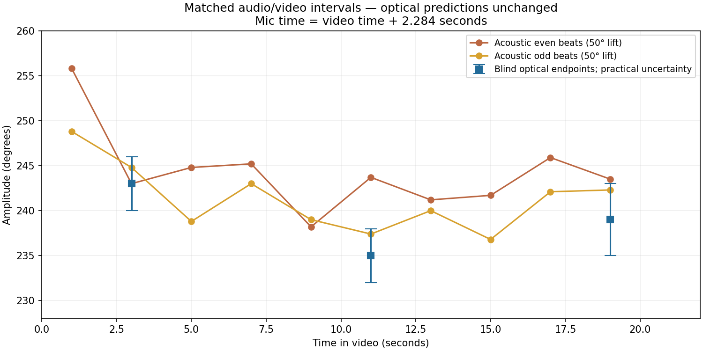
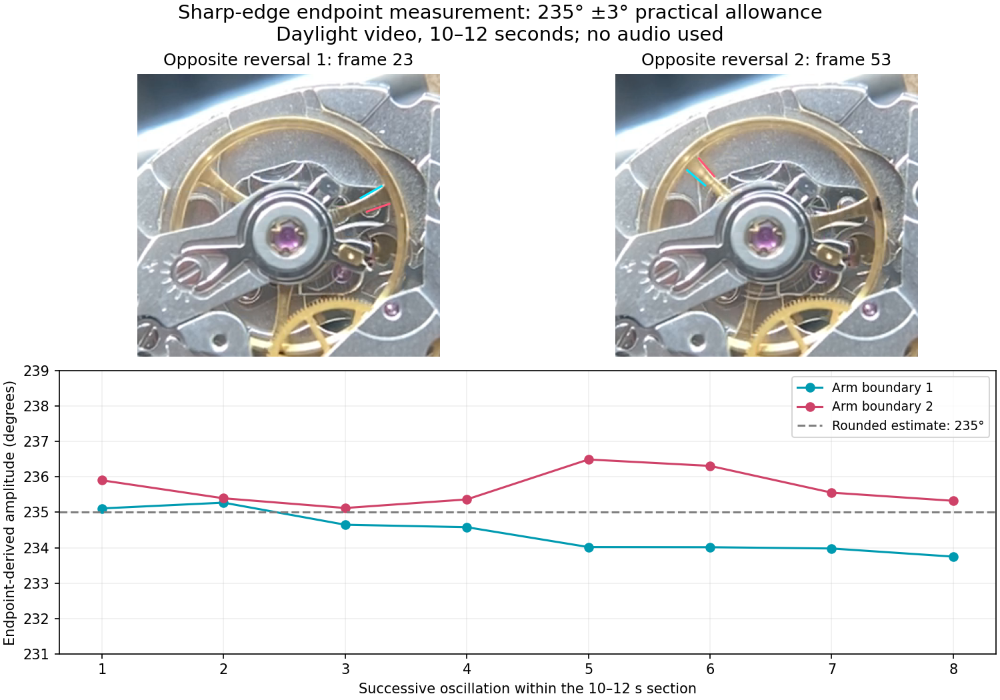

# Optical amplitude comparison: 2824-2 clone, 2026-11-03

A dial-up recording of one ETA 2824-2 clone provides an optical check on
Timegrapher's acoustic amplitude. The optical estimates were recorded before
receiving the Linux microphone take. They were not adjusted after seeing its
results. This is a single-specimen experiment, not a calibrated amplitude
standard, a family-wide lift-angle determination, or an automated regression gate.

## Matched results

All intervals below are seconds from the beginning of `IMG_5824.MOV`.
The acoustic replay used **28,800 bph and a 50° lift angle**.

| Video interval | Blind optical amplitude | Acoustic Tick (`even`) | Acoustic Tock (`odd`) |
| --- | ---: | ---: | ---: |
| 2–4 s | 243° ± 3° | 243.0° | 244.8° |
| 10–12 s | 235° ± 3° | 243.7° | 237.4° |
| 18–20 s | 239° ± 4° | 243.5° | 242.3° |

Tick/Tock here identify the analyzer's alternating groups in this replay; they
have not been mapped to a particular clockwise/counterclockwise optical swing.
The optical value is half the travel between opposite reversals. It does not
independently measure each side's amplitude about a separately established rest
position. Thus the acoustic columns are useful diagnostics, not two independent
optical validations of directional amplitude.

The arithmetic means of the acoustic pairs exceed the rounded optical values by
0.9°, 5.6°, and 3.9°. These pair means are descriptive calculations, **not the
app's pooled amplitude statistic**. The middle interval's Tock estimate is within
the optical allowance while Tick is about 9° higher. This observation motivates
checking sound-event selection; it does not by itself establish a software fault
or a wrong lift angle. The saved app summary covers a different interval and is
not substituted for these matched windows.

## Capture and synchronization

The video was recorded in daylight using an iPhone 11 Pro with a 10x watchmaker's
loupe taped over its camera. It contains approximately 21.873 s at nominal
240 fps, encoded at 1280 × 720 with portrait display rotation. The balance is
about 250 pixels across. The take contains 29.952 s of mono 48 kHz, 16-bit PCM
from a Linux recording session. The session identifies itself as
`timegrapher-app 0.4.2` and records a 50° lift setting.

High-pass/band-pass inspection distinguishes three matching sharp transients
from the phone's much larger low-frequency background. Times of the 1 ms RMS
band-pass envelope peaks were:

| Phone/video audio | Mic audio | Mic minus phone |
| ---: | ---: | ---: |
| 4.193 s | 6.475 s | 2.282 s |
| 5.265 s | 7.549 s | 2.284 s |
| 7.163 s | 9.447 s | 2.284 s |

The comparison uses **mic time = video time + 2.284 s**. Matching these events
checks the offset to a few milliseconds locally; it does not calibrate drift
across the entire recording or phone audio-to-image latency. This timing
precision is adequate for the two-second comparisons, not a claim of exact
escapement-phase alignment. The matched mic intervals are 4.284–6.284,
12.284–14.284, and 20.284–22.284 s.

The full mic recording peaked at about −17.04 dBFS, with no digital clipping
detected by the analyzer. This is not a test for upstream analog distortion.

## Optical method and limits

The first pass fitted a sinusoidal three-arm pattern throughout the recording.
Several rotation branches were tried because a 120°-periodic arm pattern can
produce false local optima. The accepted tracks established the rotation count
and provided search windows near reversals. Their frozen, pre-audio parameters
are in `refit.json`; they are selection seeds, not independent ground truth.

The refined measurement used the two angular boundaries of a visible arm:

1. Decode native frames without frame-rate conversion and crop the balance.
2. Fit an ellipse to selected visible outer-rim arcs, including the lower arc;
   the upper arc alone poorly constrains the centre. Use the ellipse to estimate
   a planar perspective correction. This does not calibrate loupe distortion.
3. Sample gold contrast, `(R + G)/2 − B`, over radii 90–108 pixels in that
   corrected plane. Fit two blurred boundaries with independent edge widths and
   a sloped background. This is a subpixel profile fit, not a manual selection of
   an exact physical edge pixel.
4. Around each of 16 reversals per excerpt, fit a local quadratic to the nearest
   approximately five frames' edge locations. This estimates the endpoint
   between frames; no audio positions enter this fit.
5. Pair opposite reversals. The intervening arm tracks establish the extra full
   revolution: `amplitude = (360° + endpoint_max − endpoint_min) / 2` for the
   selected boundaries. Endpoint pictures alone cannot establish that count.

The unrounded means of the two boundary estimates across eight oscillations are
243.071°, 235.052°, and 238.863° for the three excerpts. Extra decimal places are
retained for replay, not claimed as physical precision. In the middle excerpt,
the two boundaries average 234.420° and 235.683°. In the late excerpt they average
237.327° and 240.399°, which is why its allowance is wider.

The **±3°/±4° values are investigator-assigned practical allowances**, based on
boundary disagreement, repeatability and geometry/radius sensitivity checks.
They are not standard errors, 95% confidence intervals, or bounds with measured
coverage. No seeded coverage study or lens calibration was performed. The
remaining limitations include reflections and background structure at an edge,
frame/exposure timing, uncertainty in the projected rotation centre, selection
priors, and non-projective loupe distortion. Treat these allowances as provisional.
The earlier ±10° figure was a conservative initial allowance; the endpoint study
refined it before audio was revealed. Amplitude also changes during the take, so
one constant value with a narrow band cannot describe every interval.

## Evidence and replay

The [evidence folder](assets/amplitude-validation/2824-clone/2026-11-03/) contains
frozen blind results, individual boundary measurements, selected unscaled frame
crops, matched acoustic windows, analyzer provenance and the comparison figures.
[Replay instructions](assets/amplitude-validation/2824-clone/2026-11-03/analysis/README.md)
describe the standalone experiment script. It changes no engine computation,
calibre record, corpus baseline, or user-facing application behavior.

The acoustic results were produced by the Linux 0.4.2 CLI at commit `8002cdc`,
as recorded in the saved JSON's `software` block. The capture app's exact commit
is not recorded in the supplied session. A newer CLI may produce different
results; retain those as a new comparison rather than overwriting this evidence.

**Raw-media archival upload is still pending.** The source originals remain with
the contributor; `manifest.json` records exact filenames, sizes and SHA-256 hashes.
Its null archive URLs explicitly indicate that the original MOV and WAV are not
currently downloadable from this PR. Source identity and full replay can be checked
by someone with those originals; this is not yet a self-contained public dataset.
Store large media as release/corpus assets, with stable links and hashes, rather
than adding the full MOV to normal Git history. Review room audio and strip
location metadata from a public distribution copy, retaining its hash separately
from the original's. No corpus licence or reference/holdout status is assigned here.

## A subsequent DD32xx experiment

The same evidence format can support a DD32xx study once the specimen is identified.
Record several stable amplitude levels, fix the optical protocol and uncertainty
checks before revealing audio results, and place synchronization taps near both
ends. Preserve raw sound-event times and compare candidate lift settings on the
same intervals. A candidate setting's agreement at one amplitude cannot alone
separate lift-angle error from sound-event timing bias or optical systematic error.
Any proposed calibre change needs its own evidence and review.
