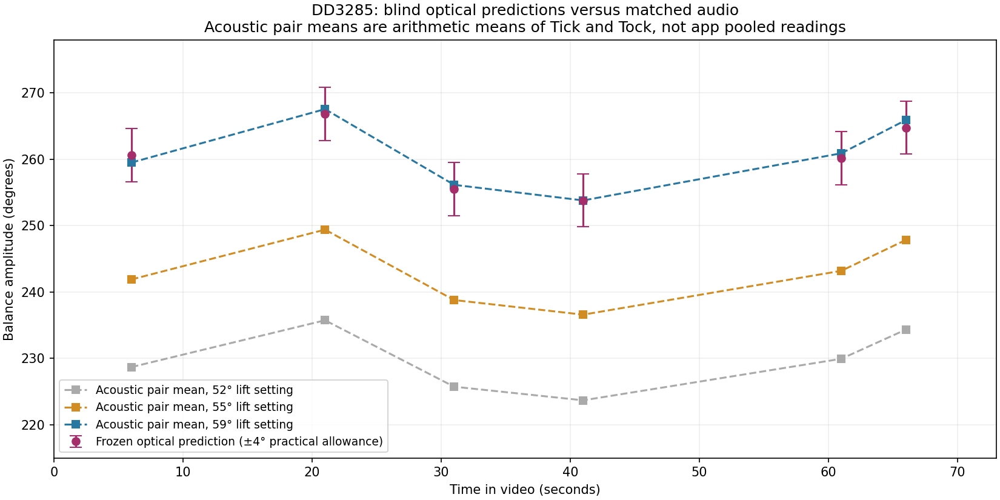
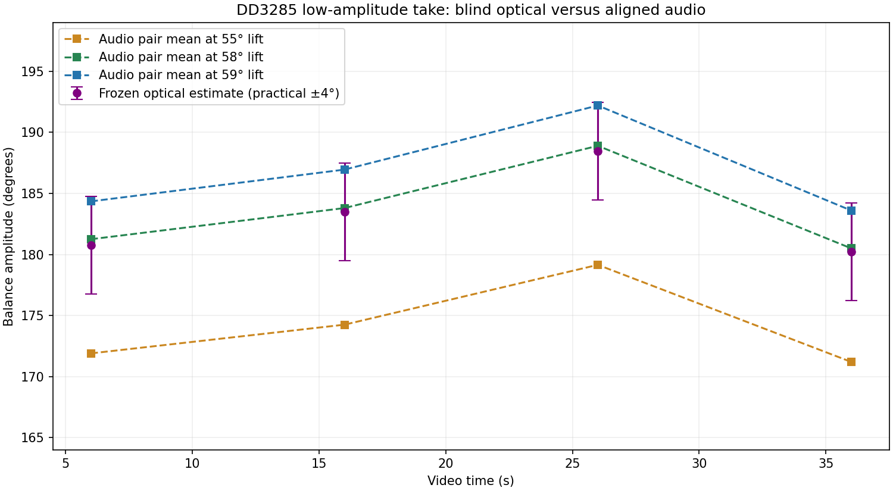
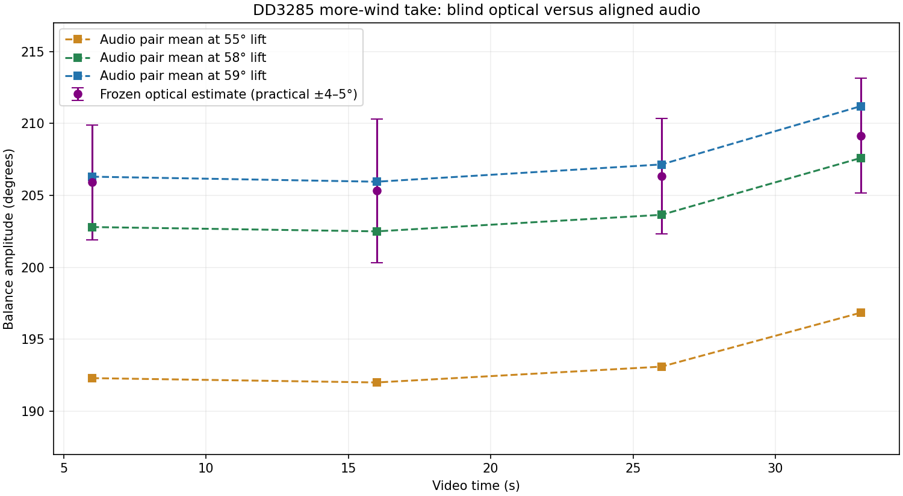
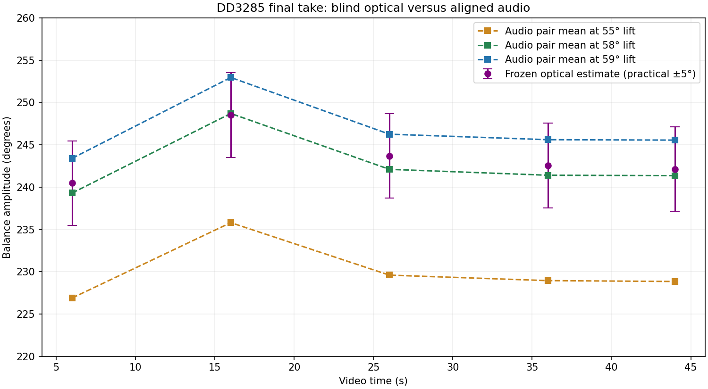
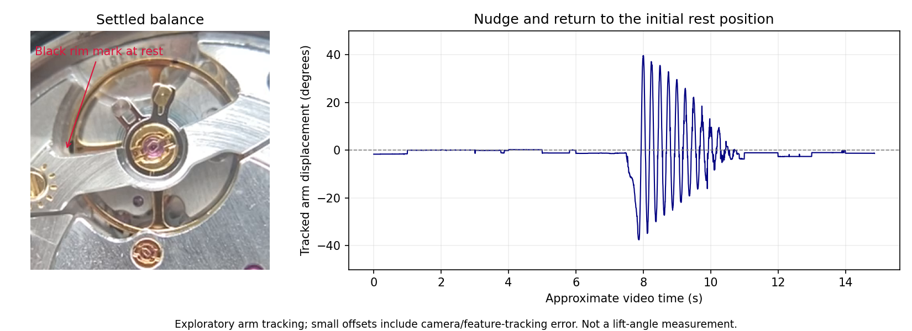

# DD3285 optical amplitude comparisons, 2026-11-03

Four dial-up takes of **one contributor-identified DD3285** compare blind optical
balance measurements with synchronized microphone measurements. A fifth video
records the balance settling after a nudge. The catalogue adopts **59°** as an
empirical lift setting for the DD32xx and JH32xx families by maintainer decision.
It is not a manufacturer specification or an exact physical lift-angle measurement.
No JH specimen or other DD variant was separately measured.

The selected 59° setting places the acoustic pair mean within the recorded
practical optical allowance in **all 19 matched intervals**. The original 55°
setting underreads beyond that allowance in every interval. A 58° replay fits the
low and final takes more closely, but underreads two high-take intervals beyond
their allowances. These allowances are investigator judgments, not confidence
intervals: agreement with them is descriptive evidence, not a statistical test.

## Scope of the catalogue decision

Only the two canonical rows `Dandong 3235` and `JH3235` change from **55° to 59°**.
Their existing aliases cover DD/JH 3230, 3235, 3255, 3285 and 32xx, the corresponding
Dandong/Jinghe names, and `VS3235` under the Dandong row. There are no new aliases.
The DD evidence is extrapolated to the other variants and to JH by maintainer
decision; sharing a train does not itself prove a shared lift angle.

Genuine Rolex 32xx, its 53° variants, VR32xx, SH32xx, DD31xx, DD324 and all other
rows retain their values. Tooth counts, wheel periods and beat rates do not change.
The row-level `confidence` still describes the photographed train evidence, not
the certainty of this lift setting; the field-specific limitations are in `notes`.

For fixed selected sound events, the core amplitude calculation is proportional
to the supplied lift angle. Using the new catalogue setting increases amplitude
by `59/55 − 1 = 7.27%`: an otherwise identical 220° reading becomes 236°.
This does not change sound-event detection, rate, beat error or any estimator.
Explicit lift overrides and historical saved sessions that retain 55° remain
55° inputs. The measured replays below use explicit settings and are not rewritten
to pretend they were captured at the new default.

## Blind protocol and results

The contributor withheld each microphone take until the corresponding optical
estimates had been reported and frozen. The first high take established the
candidate near 59° after its audio was revealed. The low take motivated checking
58° afterward. Both were already candidates before the intermediate and final
audio arrived. Later optical work was blind to its own matching audio, **not**
blind to previous takes or to the candidate settings. There was no preregistered
universal protocol or independent investigator replication.

Capture order was high, rest, low, intermediate, final. Each optical estimate is
half the total unwrapped travel between opposite turning points. It does not
independently determine each direction's amplitude about a calibrated rest zero.
The microphone's alternating Tick/Tock groups have not been mapped to clockwise
and counterclockwise optical motion.

The table below uses the arithmetic mean of Tick and Tock for comparison.
**This descriptive pair mean is not the application's pooled amplitude statistic.**
The evidence includes both groups and their unlock/drop event times separately.
Intervals are seconds from the start of each source video. Values with an extra
decimal are replay arithmetic, not claims of sub-degree physical precision.

| Take / video interval | Frozen optical | Audio at 55° | Audio at 58° | Audio at 59° |
| --- | ---: | ---: | ---: | ---: |
| high / 5–7 s | 261° ± 4° | 241.9° | 255.1° | 259.5° |
| high / 20–22 s | 267° ± 4° | 249.4° | 263.0° | 267.5° |
| high / 30–32 s | 255° ± 4° | 238.8° | 251.9° | 256.1° |
| high / 40–42 s | 254° ± 4° | 236.6° | 249.5° | 253.8° |
| high / 60–62 s | 260° ± 4° | 243.2° | 256.5° | 260.9° |
| high / 65–67 s | 265° ± 4° | 247.8° | 261.4° | 265.9° |
| low / 5–7 s | 181° ± 4° | 171.9° | 181.2° | 184.4° |
| low / 15–17 s | 183° ± 4° | 174.2° | 183.8° | 186.9° |
| low / 25–27 s | 188° ± 4° | 179.2° | 188.9° | 192.2° |
| low / 35–37 s | 180° ± 4° | 171.2° | 180.5° | 183.6° |
| intermediate / 5–7 s | 206° ± 4° | 192.3° | 202.8° | 206.3° |
| intermediate / 15–17 s | 205° ± 5° | 192.0° | 202.5° | 205.9° |
| intermediate / 25–27 s | 206° ± 4° | 193.1° | 203.7° | 207.2° |
| intermediate / 32–34 s | 209° ± 4° | 196.8° | 207.6° | 211.2° |
| final / 5–7 s | 240° ± 5° | 226.9° | 239.3° | 243.4° |
| final / 15–17 s | 249° ± 5° | 235.8° | 248.7° | 252.9° |
| final / 25–27 s | 244° ± 5° | 229.6° | 242.1° | 246.2° |
| final / 35–37 s | 243° ± 5° | 228.9° | 241.4° | 245.6° |
| final / 43–45 s | 242° ± 5° | 228.8° | 241.4° | 245.6° |

The per-take effective setting is calculated for each interval as
`55 × optical amplitude / acoustic pair mean at 55°`, then averaged descriptively:

| Take | Mean optical amplitude | Mean effective setting |
| --- | ---: | ---: |
| Low | 183.2° | 57.88° |
| Intermediate | 206.7° | 58.73° |
| Final | 243.5° | 58.22° |
| High | 260.3° | 58.92° |

The variation is not monotonic with amplitude. The lowest-amplitude and final
takes favor approximately 58°, while the other two favor approximately 59°.
Shared optical errors do not average away across cycles or intervals. No pooled
confidence interval or exact physical lift angle is inferred from these means.
The persistent Tick/Tock split also leaves acoustic event-selection bias unresolved.

The high-take figure is the original historical comparison at 52°, 55° and 59°.
Its 58° column above was replayed during documentation preparation, after all
blind results were frozen. The original figure and JSON remain unchanged.

## Capture, source identification and alignment

The setup used an iPhone 11 Pro with a 10x watchmaker's loupe, nominal 240 fps,
1280 × 720 encoded frames displayed in portrait, and daylight illumination.
The roughly 225-pixel balance has four arms, a black rim mark at an arm junction,
and a blue mark offset from another junction. The blue mark was not sufficiently
distinct to support an independent precision measurement. The watch had to be
removed from its stand for winding, so crop geometry was fitted separately for
each take rather than transferring a fixed camera coordinate system.

All four supplied microphone sessions record 48 kHz, 16-bit mono, 28,800 bph,
55° lift and capture app version 0.4.2. Their saved catalogue label is `Dandong
3235`; the specimen is identified here as DD3285 by the contributor. The replay
uses explicit beat rate and lift settings rather than inferring them from that
label. Sanitized session metadata and hashes of the untouched originals are saved.

Synchronization used sharp transients in a 2–12 kHz band-pass, compared through
1 ms RMS envelopes. The matching events and local offsets are retained in each
take's comparison JSON:

| Take | Video duration | Mic duration | Mic time = video time + | Matching taps |
| --- | ---: | ---: | ---: | ---: |
| High | 73.270 s | 75.136 s | 3.419 s | 1 |
| Low | 42.180 s | 50.816 s | 5.691 s | 2 |
| Intermediate | 36.015 s | 81.237 s | 42.525 s | 3 |
| Final | 47.650 s | 61.611 s | 10.376 s | 2 |

Repeated taps agree within about 1 ms. This supports a constant offset over those
takes, not an independent phone audio-to-image latency calibration. The high take
has only one matching tap and no independent whole-recording drift check. Earlier
microphone transients in the intermediate recording are not the video taps; using
the largest unrestricted correlation peak would select the wrong offset.
No full-scale digital clipping was found. That does not exclude analog distortion
or limiting upstream of the recorded samples.

## Optical method and uncertainty

1. Decode native frames without rate conversion and crop a 300 × 300 region.
2. Fit the visible rim to an ellipse and use its symmetric matrix to approximate
   planar perspective correction. This does not calibrate loupe distortion.
3. Fit the four-arm motion to establish the rotation branch and find reversal
   neighborhoods. Frozen selection fits, crop coordinates and ellipse coefficients
   are retained; no acoustic result selects a turning point.
4. In the high and final takes, fit the dark rim-marker profile near each reversal.
   In the low and intermediate takes, use the lower arm's two gold-contrast edges;
   the rim marker is not clearly exposed at both endpoints at these amplitudes.
5. Fit local quadratics to the neighboring frame positions to interpolate the
   reversal. For the selected features, the tracked full revolution gives
   `amplitude = (360° + endpoint_max − endpoint_min) / 2`.
6. Average opposite-reversal pairs. For the arm method, reject an edge's pair if
   either fitted vertex lies outside ±2.5 frames of its search center; average
   each edge's accepted pairs, then give the two edge means equal weight.

High, low and intermediate windows contain seven complete reversal pairs; final
windows contain eight. Low/intermediate exclusions are recorded per edge and pair.
The final leading-edge crosscheck uses different arms separated by a nominal 90°;
it is not a second independent marker. Trailing-edge fits affected by fixed
hardware are kept as diagnostics rather than averaged into the marker result.

The **±4°, ±5° allowances have no demonstrated statistical coverage**. They reflect
edge disagreement, repeated-cycle scatter, changes of radial sampling band and
±2-pixel changes to the estimated center, plus uncalibrated optics. They are not
standard errors and were not reduced by the number of cycles. No production
uncertainty statistic or automatic regression tolerance is introduced here.

## Rest-position study

The separate 14.843 s video begins with a settled balance. A nudge around 7.5 s
produces roughly 40° initial excursions, which decay by about 11 s. Exploratory
arm tracking returns within roughly 1–2° of the starting position. Transfer to
the running videos is less precise because of changed framing and several-degree
marker-profile sensitivity. The settled position is also not independently proven
to be the unloaded hairspring zero; escapement contact may influence it.

The rest study therefore supports a repeatable settled reference but is **not**
used to assign directional amplitudes or resolve the acoustic Tick/Tock split.

## Evidence, replay and remaining work

The [evidence folder](assets/amplitude-validation/dd3285/2026-11-03/) preserves
the original blind JSON files byte-for-byte, fitted endpoints, selection seeds,
geometry, sensitivity checks, native unscaled crop examples, comparison figures,
explicit-lift acoustic window CSVs and normalized matched-window tables.
[Replay instructions](assets/amplitude-validation/dd3285/2026-11-03/analysis/README.md)
describe hash verification and reproduction from the source media. Geometry and
selection priors are frozen inputs to that replay, not newly optimized evidence.

The acoustic replay is the Linux 0.4.2 CLI at **`8002cdc`**, not necessarily the
current engine. Capture app commit information is unavailable. Replaying a newer
engine should create a separate comparison rather than overwrite these results.

**Public archival upload of raw media remains pending.** Original MOV/WAV files
and identifying session files are not added to Git. The manifest records hashes
and sizes with null archive URLs. A reviewer with the originals can reproduce
the endpoints and acoustic results; without them, the committed evidence supports
inspection and arithmetic verification but is not a self-contained public dataset.
Any future distribution copy needs review of room audio and removal of location
metadata, with a separate hash from the original. No corpus licence, reference
status or holdout designation is assigned by this study.

Further independent optical calibration, direct escapement observation and
measurements of additional DD and JH specimens would be needed to promote this
empirical family default into a definitive physical lift-angle claim.
