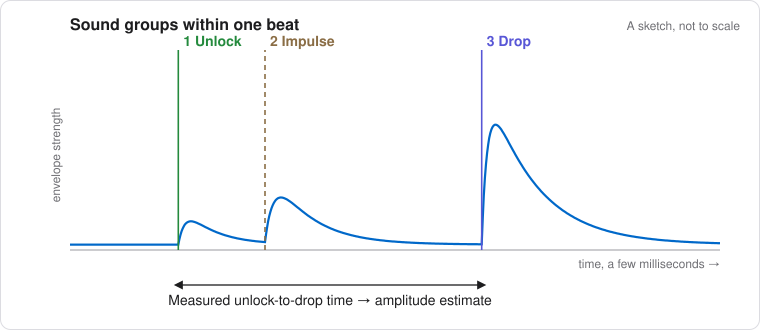

# 1. What a Timegrapher Measures

A timegrapher listens to the escapement and times its sounds. From those
times it works out how fast the watch runs, how far the balance swings,
and how evenly the two halves of each swing are timed.

It can't see the balance, feel the mainspring or look at a tooth. Knowing
which sound each number comes from tells you when to trust a number, and
when the microphone, not the watch, has changed.

This guide covers the **Swiss lever escapement** only.

## The Beat

- The balance and hairspring swing to and fro. One swing from one end to
  the other is a **beat** (or vibration). Two beats make one full
  oscillation.
- A 4 Hz balance makes 8 beats a second: **28,800 beats per hour (bph)**.
- Near the middle of each swing, the impulse pin enters the pallet fork.
  The balance unlocks the escapement, and the escape wheel gives the
  balance a push (the impulse) to keep it going.
- The next beat does the same the other way, on the other pallet stone.

The app calls the two kinds of beat **Tick** (blue) and **Tock**
(orange).

- They alternate: every second beat is a Tick.
- These are the app's labels, given when a take starts. They don't say
  which pallet stone is which.
- When the two sides sound too alike to tell apart after a gap in the
  sound, the app keeps the names by counting beats, and says so.

## The Three Sounds of a Beat

Each tick is really three sounds close together:

| Sound | What happens | Why it matters |
| --- | --- | --- |
| **Unlock** | The impulse pin strikes the fork and starts to move the lever. The pallet stone slides off the escape-wheel tooth. | The start of the lift. Amplitude and beat error are timed from here. |
| **Impulse** | The escape-wheel tooth pushes on the pallet stone's impulse face, and the fork pushes the balance. | Usually the quietest. It sits between the other two. |
| **Drop** | The escape wheel turns freely, then a tooth lands on the other pallet stone, and the lever reaches its banking. | Usually the loudest. The end of the lift. |

- Strictly, *drop* is the escape wheel's free turn. The microphone hears
  the knock at its end.
- The three sounds don't always show as three clean peaks. The case, the
  holder and the microphone change how loud each one sounds.

Sources:

- Witschi, _Measuring Technology and Troubleshooting for Watches_,
  [training course PDF](https://www.welwynwatches.co.uk/uploads/9/1/4/3/9143536/witschi_training_course.pdf),
  on the sound groups.
- Horopedia, [Swiss lever escapement](https://horopedia.org/distribution-mechanism-swiss-lever-escapement/),
  sections 6 and 9, on the mechanical sequence.

## The Four Things It Measures

### Beat Rate

**What it is:** how many beats an hour the movement is made to make, such
as 28,800 bph.

| Balance | Beat rate | Time between beats |
| --- | --- | --- |
| 2.5 Hz | 18,000 bph | 200 ms |
| 3 Hz | 21,600 bph | 166.7 ms |
| 4 Hz | 28,800 bph | 125 ms |
| 5 Hz | 36,000 bph | 100 ms |

**Why it matters:** every other reading is worked out against it. A
steady strip at the wrong beat rate gives wrong readings.

### Rate

**What it is:** how many seconds a day the watch would gain or lose if it
kept running exactly as it is now. **+10 s/d** gains, **−10 s/d** loses.

**Why it matters:** it is what the owner notices on the wrist. It changes
with position, wind and temperature, so one reading describes one
moment, not the watch.

**How it is heard:** at 28,800 bph, +10 s/d makes each beat about
14.5 microseconds early. The app fits a line through many beat times
rather than timing one beat.

**The sound card's clock:** the microphone's sound card keeps its own
time, and it is rarely exact. A card 20 parts per million off moves every
rate by about 1.7 s/d. The app corrects for this where it can.

### Amplitude

**What it is:** how far the balance turns from rest to the end of its
swing, in degrees. At 270°, the balance travels about 540° from one end
to the other.

**Why it matters:** it shows how much energy reaches the balance. It
changes with wind, position, lubrication and wear.

**How it is heard:** the time from unlock to drop is the balance passing
through the **lift angle**, a small arc set by the movement's design. A
balance swinging wider passes through that arc faster.

**What it needs:** the right lift angle. Every amplitude is in proportion
to it, so 52° instead of 55° reads about 5% low. The lift angle comes
from the calibre; with none set, the app uses 52° and says so.

### Beat Error

**What it is:** how unevenly the Tick and Tock halves of the swing are
timed. If one half takes 124.7 ms and the next 125.3 ms, the beat error
is half the difference, **0.30 ms**.

**Why it matters:** it shows whether the balance's rest point sits
centred in the escapement.

**How it is heard:** from the unlock of each beat. The Beat Error card's
hover also gives a figure timed from the drop. When the two differ, the sound of the two
sides differs; that alone says nothing about the escapement.

**Its sign:** the cards show the size only, because which side is "Tick"
is the app's label, not the watch's.

## Precision Is Not Accuracy

Three different things:

- **Precision:** how much the reading scatters. The **±** beside each
  figure estimates this.
- **Steadiness:** how much the watch itself changes over time. The
  Steadiness panes look at this.
- **Accuracy:** how close the figure is to the truth. A wrong lift angle
  or an uncorrected sound card clock can give a precise reading that is
  wrong.

A small ± doesn't mean the setting behind a reading is right, or that the
next take will read the same.

---

Next: [Your First Take](02-your-first-take.md)
