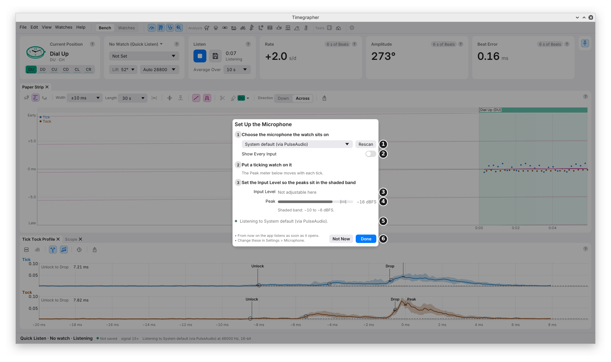
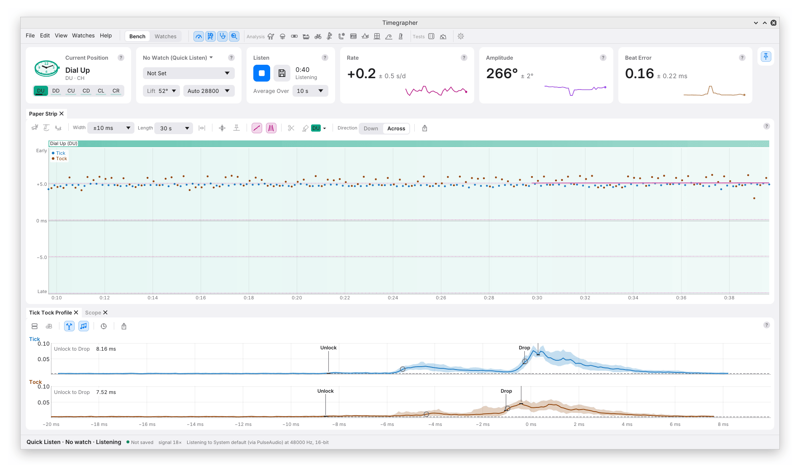
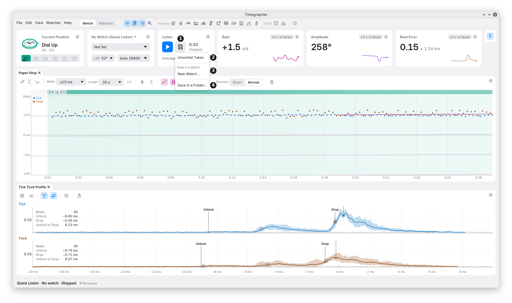

# 2. Your First Take

**Quick Listen** is the fastest way to measure a watch. Put it on the
microphone and press one button. There is no watch to set up first. This
chapter walks through it once, from installing the app to saving the
take.

## What You Need

- **The app** for your computer, from the
  [Releases page](https://github.com/peterhudson/timegrapher/releases/latest).
  [Installing and updating](../reference/install.md) has the details for macOS,
  Windows and Linux.
- **A timegrapher microphone:** a contact microphone in a watch holder.
  An ordinary microphone often hears the loud drop but misses the quiet
  unlock, so rate works and amplitude doesn't.
- **A mechanical watch** with a Swiss lever escapement, fully wound.
- **Its calibre**, if you know it. The calibre gives the lift angle,
  which amplitude needs.

## Install and Open

- **macOS:** open the disk image and drag the app to Applications.
- **Windows and Linux:** extract the whole download and run the app from
  that folder. Keep its files together.
- The builds aren't signed, so the system may ask you to approve the
  first launch. Allow microphone access when asked.

## Set Up the Microphone

The first time the app opens, it asks you to set up the microphone. It
starts listening at once, so you can see the watch as you set it up.

| Mark | Control | What it does | Why you'd use it |
| --- | --- | --- | --- |
| 1 | **Microphone** menu and **Rescan** | Picks the input to listen to. Rescan looks for inputs again. | To pick the microphone the watch sits on. Rescan after plugging one in. |
| 2 | **Show Every Input** | Lists every input the system offers, with its id. | When your microphone is missing from the short list. |
| 3 | **Input Level** | The microphone's gain, where the app can set it. | To bring the peaks into the shaded band. |
| 4 | **Peak** and its shaded band | How loud the latest ticks reach, against −10 to −6 dBFS (decibels below the loudest the input can record; chapter 3). | Peaks in the band are loud enough to time the quiet unlock, with room to spare before clipping. |
| 5 | Status line | What the app is doing, or why the input failed. | To see at once if the input won't open. |
| 6 | **Not Now** and **Done** | Done keeps listening, and from then on the app listens as soon as it opens. Not Now stops listening, and the sheet doesn't come back by itself. | Done for a microphone you'll use every day. |

- In this picture the sound comes from a recording played through a
  virtual microphone, so **Input Level** reads "Not adjustable here" and
  the peak sits below the band. On your microphone, raise the level until
  the peaks sit in the band.
- You can change all of this later in **Settings > Microphone**.
  [Setting Up the Microphone](03-setting-up-the-microphone.md) explains
  each control.

## Listen

1. **Put the watch on the holder, dial up.** Make the contact firm and
   repeatable. Stop a loose bracelet rattling against the holder.
2. **Press Listen** (the blue ▶ on the **Listen** card). It becomes a
   ■ Stop button while the app listens.
3. **Wait about half a minute.** The first readings come after a few
   seconds of beats. They steady as more beats arrive.
4. **Leave the watch and the table alone.** A knock shows as a jump.

### What to Read First

- **The Calibre card's Beat Rate:** "Auto 28800" means the app heard
  28,800 bph. Check it matches the movement.
- **Rate, Amplitude and Beat Error:** the figures, each with its ± and a
  small chart of the take so far.
- **Lift 52°:** with no calibre set, the app assumes 52°. Pick the
  calibre on the Calibre card to use its own lift angle. Until then,
  treat the amplitude as a rough figure.
- **The Paper Strip:** one dot per beat. A steady watch draws two flat,
  parallel lines.
- **The Tick Tock Profile:** the average sound of a Tick and of a Tock,
  with the Unlock and Drop marks the readings are timed from.
- **The status bar:** "Quick Listen · No watch · Listening", whether the
  take is saved, and the signal: how far the ticks stand above the noise.

### Why the Figures Move

- The cards read the last **10 s** of beats unless you change **Average
  Over** on the Listen card. Some movement in the last digit is normal.
- A repeated pattern, a sudden step or an unsteady strip tells you more
  than the last digit does.
- The **±** is the scatter between short readings. It doesn't check that
  the lift angle or the microphone are right.

## Stop and Save

Press **■ Stop**. The take stays on the Bench to look through, and the
microphone is free for other programs. A Quick Listen take isn't kept
until you save it.

The **Save** button (the floppy disk beside Listen, mark 1) opens this
menu:

| Mark | Choice | What it does | Why you'd use it |
| --- | --- | --- | --- |
| 2 | **Unsorted Takes** | Keeps the take in Unsorted Takes, in the Watches view. | To keep a take now and file it under a watch later. |
| 3 | **Keep in a Watch** | Lists your watches. **New Watch…** adds one first. The take takes the watch's calibre, lift angle and beat rate. | To build a watch's history and compare its takes later. |
| 4 | **Save in a Folder…** | Saves the take into a folder you choose. | To keep a take outside your watches, for example to share it. |

- You can also keep a take in a watch **while still listening**: pick
  the watch from Keep in a Watch, and listening carries on into it.
- Once kept, the take records into its folder as it goes, every 5 s.
- **Listen** again starts a new take. **An unsaved Quick Listen take
  goes without a question**: save it first if you want to keep it. A
  test's take is asked about once more than 5 s of it is unsaved.

Chapters 22, The Watches View, and 23, Takes and Sound Files, cover
watches and saving in full.

## No Microphone? Open a Recording

- **File > Open Recording…** opens a WAV or FLAC file (two common sound
  file formats; FLAC, the Free Lossless Audio Codec, keeps every sample
  in less space) and analyses all of it at once.
- **File > Open Folder…** opens a saved take, or a folder of recordings
  of one long run.
- The public [test corpus](https://github.com/peterhudson/timegrapher-corpus)
  has recordings to try.

---

Previous: [What a Timegrapher Measures](01-what-a-timegrapher-measures.md) ·
Next: [Setting Up the Microphone](03-setting-up-the-microphone.md)
