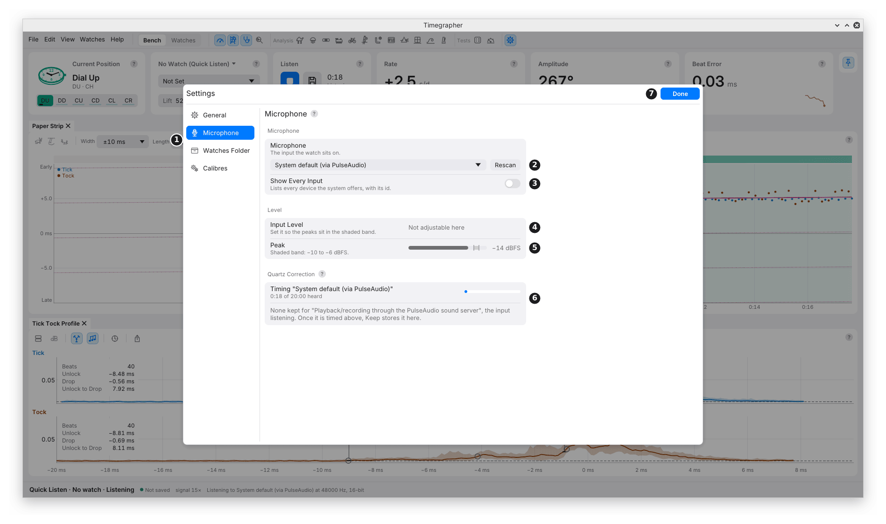

# 3. Setting Up the Microphone

A good rate needs only the loud drop. A good amplitude and beat error
also need the quiet unlock, timed the same way every beat. So a setup
that gives a steady rate can still give a poor amplitude.

The aim: firm contact, enough level, no clipping, and no processing of
the sound on its way in.

## Settings > Microphone

Open Settings with the gear at the right of the top row, **Edit >
Settings…** (**Timegrapher > Settings…** on a Mac), or **Ctrl+,**
(**Cmd+,** on a Mac). Then pick **Microphone**.



| Mark | Control | What it does | Why you'd use it |
| --- | --- | --- | --- |
| 1 | Categories | General, Microphone, Watches Folder and Calibres. Settings opens where you left it. | To move between the settings pages. |
| 2 | **Microphone** menu and **Rescan** | Picks the input. Rescan looks for inputs again. | To choose the microphone the watch sits on. Rescan after plugging one in. |
| 3 | **Show Every Input** | Lists every device the system offers, with its id. | When your microphone is missing from the short list. |
| 4 | **Input Level** | The microphone's gain, where the app can set it. | To bring the peaks into the shaded band. |
| 5 | **Peak** | The loudest sample of the last half second, against a band at −10 to −6 dBFS. Says "Clipping: lower the Input Level." at once on a clipped sample, for 3 s after the last one. | To set the level while a watch ticks. |
| 6 | **Quartz Correction** | Times the sound card's clock against the computer's while you listen, and keeps the error it finds. | To correct every rate for the sound card's clock. See [Quartz Correction](#quartz-correction). |
| 7 | **Done** | Closes Settings. So do Escape and a click outside. | |

- **Automatic Gain** appears here too, for an input whose automatic gain
  the app can switch. It isn't in this picture: the virtual microphone
  used for it has none.
- In this picture **Input Level** reads "Not adjustable here", for the
  same reason.

## Which Input to Choose

- **macOS and Windows:** pick the microphone by its name.
- **Linux:**
  - **System default (via PipeWire)** (or **via PulseAudio**) uses
    whatever input the desktop's sound settings choose. It works alongside
    other programs. Pick this, then choose the watch microphone in the
    desktop's sound settings.
  - An input marked **(direct)** goes straight to the sound card. It
    can't open while the desktop's sound server holds the card.
- The app asks for 48 kHz, mixes to mono, and takes 16-bit samples where
  the device offers them. The status bar says what the input opened at.

## Setting the Level

**Why:** too quiet, and the unlock is lost in the noise. Too loud, and
the tops of the ticks are cut off (clipped), which moves the drop.

- The Peak meter reads in **dBFS**: 0 dBFS is the loudest the input can
  record. −6 dBFS is half of that; −10 dBFS is about a third.
- **Aim for peaks in the shaded band**, −10 to −6 dBFS. That is loud
  enough to time the unlock, with room for a louder tick.
- **Linux:** move **Input Level** and let go; the change is made when you
  release it.
- **macOS and Windows:** the system sets the level. **Open Sound
  Settings…** opens the system's input settings. Watch the Peak meter
  here as you change it there.

### Clipping

**What it is:** a tick louder than the input can record, with its top cut
flat.

**What it does to the readings:**

- It moves the drop, so the amplitude and beat error move.
- The rate isn't affected.
- Turning the level down afterwards can't repair a clipped recording.

**How the app shows it:**

- The Peak meter says "Clipping: lower the Input Level." the moment a
  sample clips, and keeps saying it for 3 s after the last one.
- The Amplitude and Beat Error cards show a chip such as **3% Clipped**:
  the share of the beats in the reading that clipped. It goes once the
  clipped beats leave the reading.

### Automatic Gain

**What it is:** the microphone turning its own gain up and down as the
sound changes.

**Why it matters:** it changes the level between and during ticks, which
moves the unlock and the drop.

- The switch shows only for an input whose automatic gain the app can
  reach. It is **off by default**, and kept for each input.
- Each time the app opens the input, it sets the switch again. Some
  stands turn it back on each time they are plugged in.
- If the microphone reports a different setting, the row says so.
- The switch's absence doesn't prove the sound is unprocessed. Turn off
  noise suppression and any "voice" processing in the system's settings
  too.

## The Signal Figure

The status bar shows **signal**, for example **signal 15×**, while
listening.

- **What it is:** how far a typical tick's peak stands above the typical
  level between ticks.
- **Noise alone** reads about 2×. Below 4×, no beats are logged.
- **What it doesn't tell you:** it measures loudness, not the shape of
  the tick. Hum, knocks, or a holder that smears the sound can still
  give a high figure. Check the Tick Tock Profile as well.

## Quartz Correction

**What it is:** the sound card times the sound by its own quartz crystal.
That crystal is usually 10 to 50 parts per million (ppm) off, which moves
every rate by 1 to 4 s/d.

**How the app measures it:**

1. While you listen, the app times the sound card's clock against the
   computer's.
2. After 20 minutes, once the error is known to half a ppm, Quartz
   Correction offers it with a **Keep** button.
3. Keep stores it for that input.

**What it changes:**

- The **Rate** card's big figure stays on the sound card's clock, the
  same clock other timegraphers and `timegrapher analyze` use.
- The Rate card's hover adds the rate corrected onto true time, labelled
  **True Clock**, with the day the correction was kept.
- A saved take is read on its own clock log instead, so a reopened take
  is corrected for the card it was recorded on.

**When to use it:** once for each microphone you use regularly. Measure
it again after changing the microphone or sound card behind an input's
name.

**What it needs:** the computer's clock kept by internet time (NTP). A
busy computer delivers sound less evenly, so the offer can come later.

## Placing the Watch

- **Firm, repeatable contact.** Seat the watch the same way each time.
- **Stop rattles.** A loose bracelet or clasp against the holder adds
  knocks.
- **Isolate the stand** from the desk. Typing or a knock on the table
  shows as a jump.
- **Change one thing at a time.** If you change the holder, the contact
  or the level, note it: the readings may change with it.

## When Listening Stops

- If the input can't be opened, stops, or sends no sound for 3 s, the
  app stops listening and says why.
- A watch that is silent or too quiet is different: listening carries
  on, and the cards say **No regular beat found**.

## Checking from the Command Line

`timegrapher doctor` checks a microphone or a recording: peak and
average level, clipped samples, beats found, and whether the background
rises between beats (a sign of automatic gain).

```sh
timegrapher doctor --file watch_DU.flac
timegrapher devices
timegrapher doctor --device "USB"
```

- Stop listening in the app first if the device can't be shared.
- On Linux, doctor can suggest mixer changes. It makes them only with
  `--apply`. Read the suggestions first.

---

Previous: [Your First Take](02-your-first-take.md) ·
Next: [The Window](04-the-window.md)
