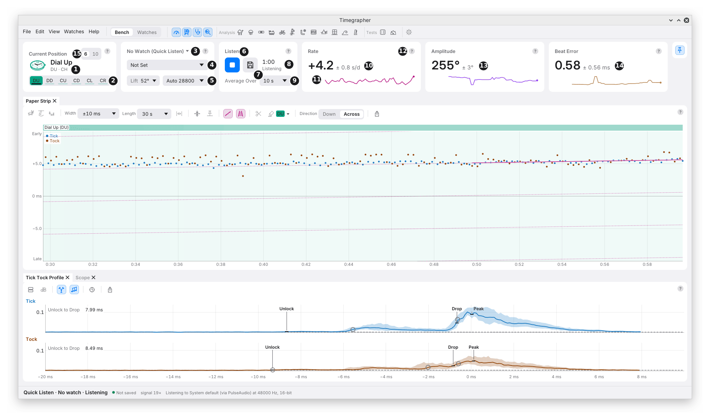
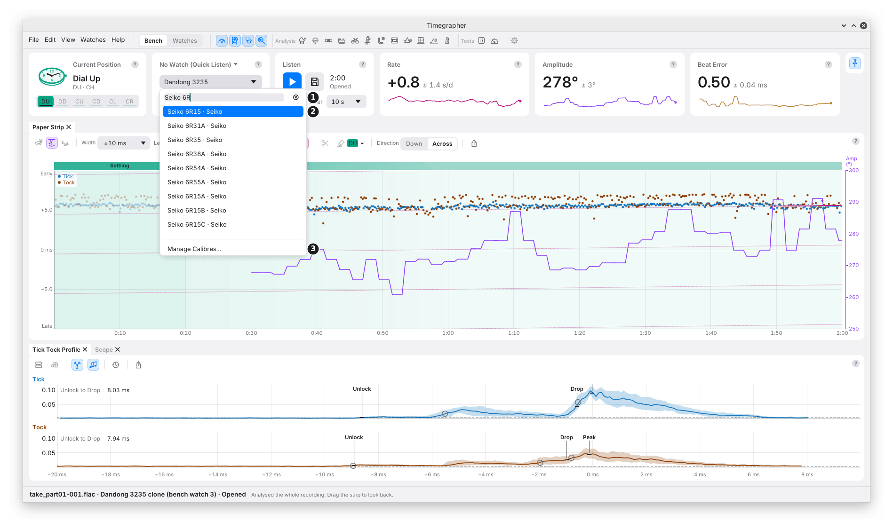
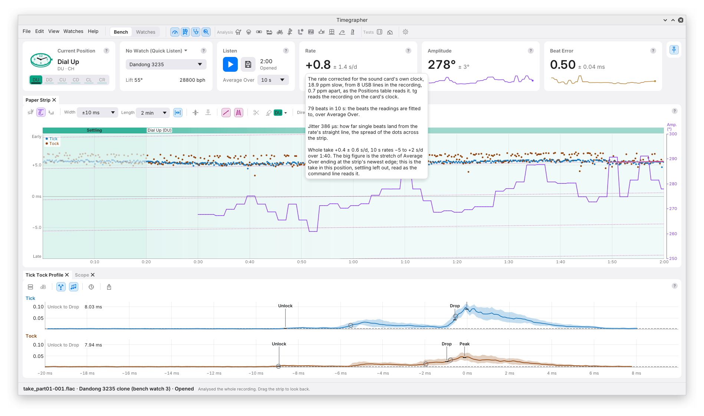

# 5. The Readings Cards and the Calibre Card

The six cards across the top of the Bench hold everything the app knows
about the take on show: where the watch lies, what it is, whether it is
being heard, and the three readings.

Every card has the same three rows, so the titles, the big figures and
the controls each read in one line across:

- **The title row:** the card's name, its **?**, and a chip when
  something limits the reading.
- **The figure row:** the big figure, with its ± and unit.
- **The controls row:** the card's controls, or a small chart.

## Current Position

| Mark | Part | What it does | Why you'd use it |
| --- | --- | --- | --- |
| 1 | Picture and name | The watch as it lies, in teal: the dial for Dial Up, the case back for Dial Down, the crown at the top for Crown Up, and so on. Beside it, the name and both codes: the common one, then Witschi's ("CD · 9H"). | To check at a glance that the app has the position you put the watch in. |
| 2 | **DU DD CU CD CL CR** | Sets the position. The current one is filled. Keys **1** to **6** do the same. | Each time you turn the watch, so the readings are filed under the right position. |

- **The bar under each button** fills with the seconds heard in that
  position, settled and not masked. It is full at the Positions Test's
  **Each Position** time, 60 s unless you change it.
- **Why the bars help:** in a free-form test, where you turn the watch
  yourself, they show which positions still need time.
- **When the buttons only show:** with a take on show, or during a
  Positions Test or Power Reserve Test, the buttons show the position but
  can't change it. A saved take's positions are fixed.
- **Settling:** after each change of position, the first seconds aren't
  read while the watch settles. The button's hover gives the time.

## The Calibre Card

The Calibre card says which watch is on the microphone, and holds what
the readings are worked out for: the calibre, its lift angle and its beat
rate.

| Mark | Part | What it does | Why you'd use it |
| --- | --- | --- | --- |
| 3 | **The Watch line** | The card's title: the watch picked, or **No Watch (Quick Listen)**. Its menu: No Watch (Quick Listen), up to five **Recent** watches, **New Watch…** and **Find in Watches…**. | To choose which watch a take goes into. It is the one place on the Bench that says so. |
| 4 | **Calibre** | Picks the calibre from about 4,500, or one of your own. | The calibre sets the lift angle, which every amplitude depends on, and the beat rate. |
| 5 | **Lift** and the beat rate | The lift angle, 52° unless set; then **Auto** with the beat rate heard ("Auto 28800"), or a rate you pick. | When the calibre isn't listed, or you know better. |

### Picking a Calibre

| Mark | Part | What it does |
| --- | --- | --- |
| 1 | **Search every calibre** | Matches a calibre's name, another name for it, or its maker. ⊗ or Esc clears it. |
| 2 | The matches | ↑ and ↓ move through them; Enter picks the highlighted one. |
| 3 | **Manage Calibres…** | Opens Settings at Calibres, to add your own or change the Short List. See chapter 24. |

With the search empty, the menu offers **Not Set** (back to Auto and
52°), then **Recent** (the last six calibres used), the **Short List** by
maker, and **Custom**, your own calibres.

- **What a calibre sets:** its beat rate, and its lift angle where the
  table has one. They then show as text, not as controls.
- **A calibre that beats at another rate** than the one heard gets a chip,
  such as "Peacock SL1258 is 28800 bph". Check which is right: the
  calibre, or the watch.
- **With a watch picked,** the card names the watch's calibre. Change it
  with **Edit…** on the watch, in the Watches view. A watch whose calibre
  isn't in the table reads **No Calibre**; Lift and the beat rate set on
  the card are then saved to the watch.

### Why the Lift Angle Matters

The amplitude is worked out from the time the balance takes to pass
through the lift angle. A lift angle 3° too small reads every amplitude
about 5% low.

- With no calibre or lift angle set, the app uses **52°**, and Lift's
  hover says it is the default.
- Treat an amplitude on the default as rough until you set the calibre.
- [M4, Amplitude and Lift Angle](m4-amplitude-and-lift-angle.md) has
  the formula.

### Why Auto Is Usually Right

**Auto** finds the beat rate from the beats themselves. Set it by hand
only when Auto picks a wrong standard rate, for example on a very quiet
or noisy take. A wrong beat rate gives readings far out, or none.

## Listen

| Mark | Part | What it does | Why you'd use it |
| --- | --- | --- | --- |
| 6 | **Listen** / **Stop** | Starts a Quick Listen take, or with a watch picked, a Listen take of that watch. It becomes **Stop** while listening. | To start and stop measuring. There is no pause: Listen again starts a new take. |
| 7 | **Save** | The Save menu: Unsorted Takes, Keep in a Watch, Save in a Folder…. Hidden while a watch's take records into it, and for a test, set up or running. | See [Stop and Save](02-your-first-take.md#stop-and-save). |
| 8 | Length and state | The take's length, and its state: Not Started, Ready (a test set up, waiting for Start Test), Listening, Stopped, Opening or Opened. | To see how much has been heard. |
| 9 | **Average Over** | How many seconds of beats each reading covers: 2, 4, 10, 20, 30 or 60 s. 10 s unless changed. | See [Choosing Average Over](#choosing-average-over). |

### Choosing Average Over

| Shorter (2 or 4 s) | Longer (30 or 60 s) |
| --- | --- |
| Follows a change quickly: turning the regulator, a knock, a change of position. | Steadier figures and a smaller ±. |
| More scatter in the last digit. | Slower to show a change. |

- **One setting for the whole app.** The Paper Strip's rate line, the
  Tick Tock Profile, Charts and Distributions all average over it too.
- **Early in a take,** or after a break, there are fewer seconds of beats
  than asked for. The readings use what there is and say so in the Rate
  card's hover.
- **No reading reaches across a break**, a change of position, or more
  than 2 s with no beats: the watch may have moved or changed meanwhile.

## Rate, Amplitude and Beat Error

| Mark | Part | What it shows |
| --- | --- | --- |
| 10 | **Rate** | Seconds a day gained (+) or lost (−), with its ±. |
| 11 | Sparkline | The reading over the take so far, in the reading's colour. |
| 12 | **?** | The card's help: hover for a line, click for the whole explanation. |
| 13 | **Amplitude** | The balance's swing, in whole degrees: the average of the Tick and Tock swings. |
| 14 | **Beat Error** | The size of the beat error, in ms. |

These cards have no controls: each is its figure. [Chapter 1](01-what-a-timegrapher-measures.md) says what each measures;
[M2](m2-rate.md), [M4](m4-amplitude-and-lift-angle.md) and
[M5](m5-beat-error.md) say how.

### What the Hover Shows

Rest the pointer on a figure to see what stands behind it.

| Card | The hover adds |
| --- | --- |
| **Rate** | The sound card's clock (M3). **Listening,** with a correction kept for the input, the big figure stays on the card's clock and the hover adds the corrected rate, labelled **True Clock**. **On an opened take** with its own clock (a clock log, USB lines, or a correction saved with it), the big figure is already corrected, and the hover says by how much and from what, as in the picture. Then the beats the readings are fitted to ("79 beats in 10 s"), and the **jitter**. |
| **Amplitude** | The amplitude of the Ticks and of the Tocks, apart. |
| **Beat Error** | The beat error timed from the drop, beside the big figure's, timed from the unlock. |

- **Jitter** is how far single beats land from the steady line the rate
  is fitted to, in microseconds: the spread of the dots across the strip.
  Noise, a muffled sound and the stand add to it as well as the watch.
- **A stopped or opened take** adds the **whole take** in the current
  position, with the settling left out: the rate over every beat, the
  amplitude and beat error over every window, and the range the 10 s
  rates covered (5th to 95th percentile). The command line's
  `timegrapher session` reads the same.
- **With the strip moved back** off the newest beats, the cards read the
  stretch ending at the strip's newest edge, and the hover says so. The
  status bar stays live.

### The ±

The **±** beside each figure is how far the reading would likely move on
a repeat under the same conditions: its standard error.

- It is worked out from how the short readings in the take scatter, with
  neighbouring readings that resemble each other counted as fewer.
- **It isn't accuracy.** A wrong lift angle or an uncorrected sound card
  clock gives a small ± on a wrong figure.
- It needs at least 3 short readings, so it appears after a few seconds.
  The rate's ± needs about 30 s of unbroken beats.
- [M7, The ± and Correlated Readings](m7-the-plus-minus.md) explains it
  in full.

### Chips

A chip beside a card's ? names, as a plain fact, something the ± can't
show. Its hover gives the whole sentence; with several, the chip shows
the first and how many more ("12 s of Beats +1").

| Chip | Means | What to do |
| --- | --- | --- |
| **6 s of Beats** | The beats span under 10 s. | Wait for more beats. |
| **540 of 600 Beats** | Under 95% of the beats expected were found. | Check the contact and the level. |
| **3% Clipped** | Over 1% of the beats in the reading clipped (Amplitude and Beat Error). | Lower the input level. See chapter 3. |
| **28800 bph Heard** | The beat rate set differs from the one heard. | Check the calibre or the beat rate. |
| **1 Break** | The reading's stretch holds a break in listening, such as the computer sleeping. | Nothing; the reading is fitted either side. |
| **6.8 s Masked** | Masked time in the stretch. | Nothing; it was left out by hand. |
| **Sides Named by Count** (Beat Error) | On an opened take, Tick and Tock were named across a break by counting beats, not by their sound. | Treat the beat error's sign across that break with care. |
| **Beat Error From the Drop** | The unlock wasn't found, so the beat error is timed from the drop. | Raise the level, or improve the contact, so the quiet unlock is heard. |
| **Amplitude Read From 4 of 15 Windows** | Under 60% of the short readings in the stretch could be used. | Treat the figure as resting on less than its span. |
| **First 12 s Left Out** | Noise before the watch was heard is left out of a whole take's reading. | Nothing. |

### No Regular Beat Found

When the beats found don't come at regular intervals, the cards show no
figures, only **No regular beat found**, with the timing scatter: for
example "(timing scatter 8.6 ms, 5.2% of a beat)".

- **The rule:** over 10 s or more, a scatter of 2% of a beat or more is
  not a watch.
- **What to check:** that the watch is running and on the microphone,
  the input, and the level.
- No reading is graded. The app never says whether a figure is good.

## Compact Readings

The pin at the right end of the cards folds them into a strip, with the
position, the watch, the take's length and the three figures. See
[chapter 4](04-the-window.md#compact-readings).

On a narrow window the cards also take smaller forms by themselves:

- **Current Position** becomes **Position**, with a **Set** pop-up of the
  six positions in place of the buttons. Keys 1 to 6 still work.
- **Listen** gives the length beside its caption, and Average Over as
  **Avg 10 s**.
- **Calibre** keeps its pop-up and Lift. On the narrowest windows, the
  beat rate moves into the Calibre pop-up's menu, or for a watch whose
  calibre isn't in the table, into the Watch line's menu.

---

Previous: [The Window](04-the-window.md)
