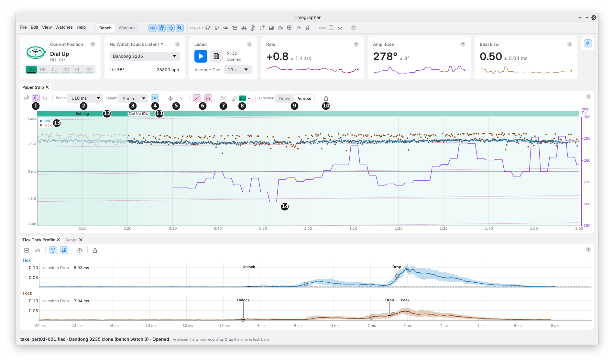
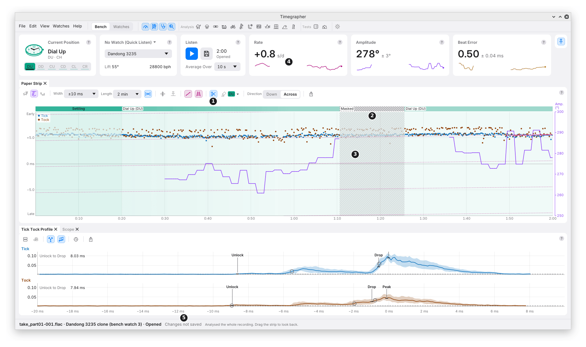

# 6. The Paper Strip

The Paper Strip draws one dot for every beat, the way a printing
timegrapher marks its paper. It shows what the readings summarise: how
steadily the watch keeps time, beat by beat.

## Reading the Strip

- **Along the strip** is time: the take's minutes and seconds.
- **Across the strip** is how early or late each beat came against a
  perfect clock beating exactly at the nominal beat rate, every 125 ms at
  28,800 bph. **Early** is up, **Late** down (with Direction set to
  Down, early is to the right): the words Witschi's training course uses
  (doc. 71.1010D35e, p. 6).
- **Tick** dots are blue and **Tock** dots orange (mark 13).
- **The amplitude** is drawn over the dots as a violet line, on its own
  scale at the right (mark 14). The rate and the beat error can be drawn
  the same way (mark 1).

| What you see | What it means |
| --- | --- |
| Two flat lines | The watch keeps the nominal rate. |
| Two lines sloping up | Each beat comes a little sooner: the watch gains. |
| Two lines sloping down | The watch loses. |
| A gap between the two lines | The beat error, timed from the drop. |
| Lines that bend | The rate is changing. |
| Dots scattered across the lines | Jitter: uneven beats, or a poor sound. |
| A sudden step in both lines | A jump: a knock, or lost sound. The readings skip it. |
| Faint grey dots | Beats in the settling time, or masked. They aren't read. |

**A line that runs off one edge comes back on the other,** like paper
wrapped round a drum. So the strip's **Width** is its zoom.

## The Toolbar

| Mark | Control | What it does | Why you'd use it |
| --- | --- | --- | --- |
| 1 | **Draw Over the Strip** | Three switches: the rate (magenta), amplitude (violet, on at first) and beat error (amber) readings drawn as lines over the dots, each on its own scale, written at the right (above the strip with Direction set to Down). | To see at a glance whether a wobble in the rate comes with a dip in amplitude. |
| 2 | **Width** | How much time fits across: from ±0.1 ms to ±60 s, typed or picked. | Narrow (±1 ms) to see a good watch's beat error; wide to keep a drifting watch from wrapping. |
| 3 | **Length** | How much time fits along: picked from 10 s to three days; typed (`45`, `5 min`, `2h`, `1:30:00`) or zoomed, from 2 s up to 80 hours. | Short to follow the last few seconds; long to see a whole take. |
| 4 | **Fit** | Shows the whole take along the strip, and keeps growing with it. | To see everything at once. Zooming or looking back turns it off; changing the width leaves it on. |
| 5 | **Centre** and **Auto-Centre** | Centre puts the newest beats on the centre line once. Auto-Centre keeps them there. | To bring the trace back after it has wrapped or drifted. |
| 6 | **Rate Line** and **Parallel Guides** | The Rate reading drawn as a magenta line over the beats it was fitted to, and faint lines at the same slope across the strip. Both on at first. | If the dots follow the line, the reading describes them well. The eye judges whether lines are parallel better than it judges a slope. |
| 7 | **Mask** | Leaves stretches out of the readings. See [Masking](#masking). | To take a knock or a handling stretch out of every reading. |
| 8 | **Position Brush** | Marks a stretch as one position. See [The Position Brush](#the-position-brush). | To correct the position after the fact. |
| 9 | **Direction** | **Across** (time left to right, the default) or **Down** (newest at the top, as on the open tg program). | Down, if you're used to a printed strip: a gaining watch leans right as it rises. |
| 10 | **Export** | Saves the strip as a PNG or SVG picture. | To share it, or put it in a report. |

**Opening a take** turns Fit on and sets the width to the narrowest listed
width that holds all the take's beats without wrapping (one stray dot in a
thousand at each end left out), so the whole take shows at once.
**Listen, or a new test,** then brings back the width, length and Fit the
strip had before the take was opened. A width or length you changed by
hand meanwhile stays as you set it.

## Moving Around

| To | Do |
| --- | --- |
| Look back through the take | The mouse wheel or a swipe, or drag along the time axis. Back at the newest beat it is live again. |
| Zoom time | **Ctrl** and the wheel (**Cmd** on a Mac), or a pinch. |
| Zoom the width | **Alt** and the wheel (**Option** on a Mac). |
| Slide the trace across | Drag across the strip. |
| Return to the newest beats | Double-click. |

**Looking back moves the cards too.** With the strip moved off the
newest beats, the readings cards, the Tick Tock Profile and the Scope
read the moment at the strip's newest edge. The strip's label says when
("at 0:40").

## The Track

The band along the top of the strip shows where the watch was and what
was left out.

| Mark | Part | What it shows |
| --- | --- | --- |
| 11 | The position | Each stretch in one position, in teal, named at its start. |
| 12 | **Settling** | The solid band after each change of position, while the balance settles. Not read. It then fades over 40 s, so each change shows. |

- **Masked** stretches show as grey hatching.
- During and after a Positions Test, the time before the test is left
  plain. On the track the time the test didn't use is plain too; on the
  strip it is hatched.

## Masking

**What it does:** leaves a stretch out of every reading, as if it were a
break. Nothing is deleted: the beats stay, faint under hatching.

| Mark | What you see |
| --- | --- |
| 1 | **Mask**, lit while on. |
| 2 | The masked stretch, named on the track. |
| 3 | Lines drawn over the strip break there. |
| 4 | The sparklines on the cards break too. |
| 5 | **Changes not saved**, on an opened recording. |

**How to use it:**

1. Turn on **Mask** (the scissors).
2. Drag along the strip over the stretch. A drag under half a second is
   ignored, as a slip of the mouse.
3. Drag a masked stretch's edge to move it.
4. Click a masked stretch, or right-click it with Mask on or off, to
   bring it back. **Edit > Remove All Masks…** brings them all back.

**What a mask changes:**

- No reading reaches across one, and nothing inside one is read.
- A chart's line comes back only once a whole Average Over time has been
  heard after it.
- The charts, the whole-take figures, the Distributions, Steadiness and a
  Positions Test all leave the masked beats out.
- A reading whose span takes in masked sound says so in a chip, such as
  **6.8 s Masked**.

**Why you'd use it:** a bump of the stand, picking the watch up, or a
noise in the room shows as a jump or a scatter. Masking it keeps one
moment from moving a whole take's figures.

**Saving masks:** a saved take keeps its masks, and the command line's
`timegrapher session` leaves them out too. On a recording opened from
disk, **File > Save** writes them beside it.

## The Position Brush

**What it does:** marks a stretch of the strip as one position, on a live
take or one opened. It corrects the position record after the fact.

1. Pick a position from the brush's menu (mark 8).
2. Drag along the strip. A teal preview says the position and the times,
   such as "CD 4:30 to 5:30".
3. **Stop Painting**, at the end of its menu, or **Esc**, puts it down.

- **Why:** you turned the watch but forgot to press the position button,
  or a recording from another app has no positions.
- Painting never starts a settling: it is a correction, not a turn of the
  watch.
- The positions recorded stay under the painting. **Right-click** a
  painted stretch on the track to take the painting off.
- Drag a change of position along the track to move it.
- Greyed during a Power Reserve Test, during or after a Positions Test
  (the test's take keeps its own positions), and while nothing is on show
  yet.

---

Previous: [The Readings Cards and the Calibre Card](05-the-readings-cards.md) ·
Next: [The Tick Tock Profile and the Scope](07-profile-and-scope.md)
