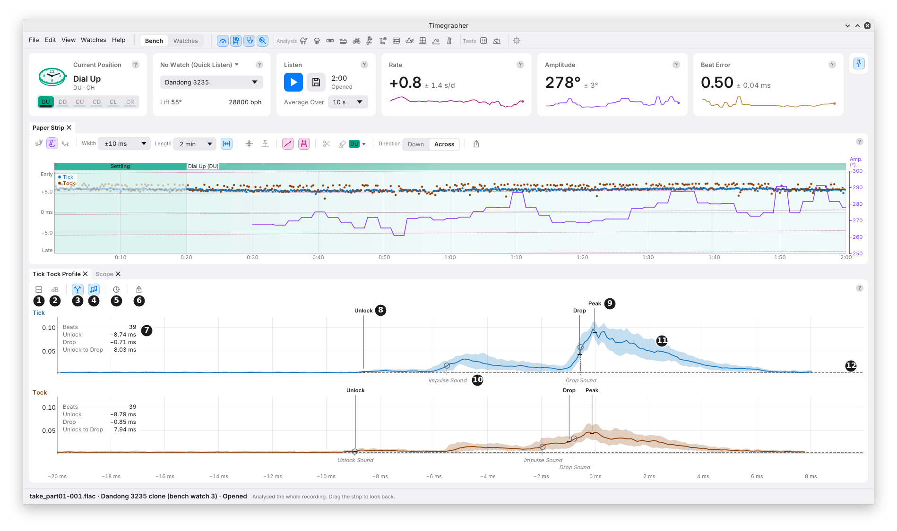
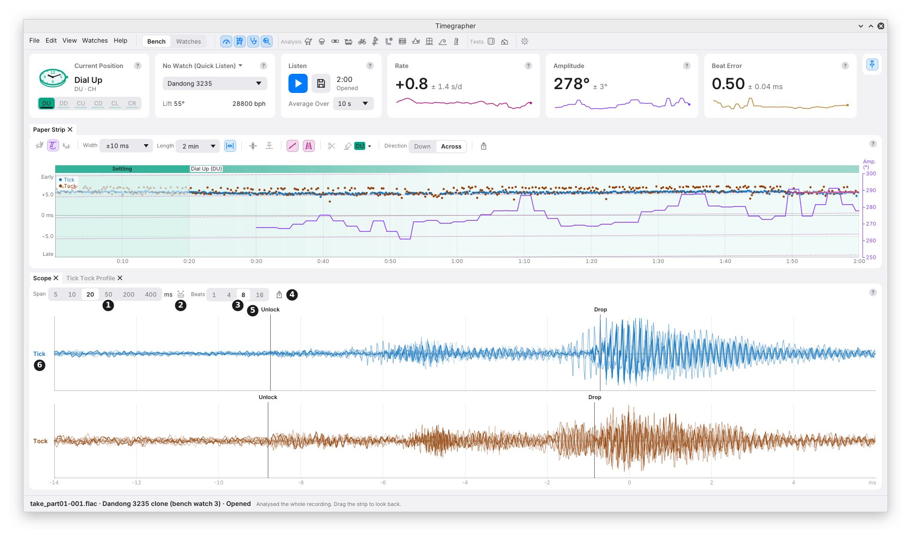

# 7. The Tick Tock Profile and the Scope

Two panes show the sound itself. The **Tick Tock Profile** shows the
average sound of a beat, with the marks every reading is timed from. The
**Scope** shows single beats as the microphone heard them.

They share a place under the Paper Strip, as two tabs. The Profile is in
front when the app starts.

## The Tick Tock Profile

**What it shows:** the typical sound of the Ticks (blue) and of the Tocks
(orange) over the last Average Over time: the same beats the readings
come from. The plot runs from 20 ms before the drop to 8 ms after it.

**Why you'd use it:** the amplitude and the beat error are timed from
the marks on these shapes. If a mark sits in the wrong place, the
readings built on it are wrong too. This is where you check.

### The Toolbar

| Mark | Control | What it does | Why you'd use it |
| --- | --- | --- | --- |
| 1 | **Layout** | **Stacked** (Tick above Tock) or **Beside** (side by side, as tg shows them). | Stacked lines the two sides up in time; Beside gives each more width. |
| 2 | **dB Scale** | Shows the level in decibels below the loudest point. Off: linear, as the app measures it. | The quiet unlock shows more clearly in dB. |
| 3 | **Edges** | The solid Unlock, Drop and Peak lines. | To see where the readings are timed from. |
| 4 | **Sounds** | The rings where the three sounds rise: Unlock Sound, Impulse Sound and Drop Sound. | To see the beat's anatomy (chapter 1). |
| 5 | **Time From** | **Shared:** both sides on one clock, so the drops stand the beat error apart. **Own Drop:** each side from its own drop, both at 0 ms. | Shared shows the beat error as a gap; Own Drop compares the two shapes directly. |
| 6 | **Export** | Saves the pane as a picture. | |

### The Plot

| Mark | Part | What it shows |
| --- | --- | --- |
| 7 | The facts | The side's Beats, Unlock and Drop (in ms), and Unlock to Drop. Tick and Tock read row against row. |
| 8 | An edge (**Unlock**) | A solid line from its name: where the reading is timed. |
| 9 | **Drop** and **Peak** | The drop's edge, and the top of the drop's sound. |
| 10 | A sound | A hollow ring where a sound has risen halfway, named in italics below the plot. |
| 11 | The band | Where the middle 80% of the beats fall. A narrow band means the beats sound alike. |
| 12 | The noise floor | The dashed line: the level in the quiet before the beat, from 20 to 17 ms before the drop. |

- **Edges and sounds** are two measurements of the same averaged sound,
  so they sit near each other but not exactly together.
- **A sound is missing** when it can't be told from its neighbour: a soft
  unlock merged into the impulse, say. In the picture, the Tick's Unlock
  Sound is missing.
- Hover a line, a ring or a name for its name and time.

### What to Look For

| What you see | What it can mean |
| --- | --- |
| The Unlock line on a clear first rise | The unlock is well heard; amplitude and beat error rest on it. |
| The Unlock line on noise, or in the middle of a ramp | The unlock is poorly heard. Treat the amplitude and beat error with care. |
| Tick and Tock with different Unlock to Drop times | The two sides read different amplitudes, and the beat error from the unlock differs from the one from the drop. |
| Tick's and Tock's marks in different places on similar shapes | A mark may be on the wrong sound. Treat the readings with care. |
| A wide band | The beats vary: a poor contact, a noise, or a changing watch. |

**Stopped,** the pane shows the sound the take kept nearest the end. On a
recording opened from a file, it is worked out from the file.

## The Scope

**What it shows:** the sound itself, beat by beat, as the microphone
heard it, filtered above 1 kHz. Not an average. It is the scope view of
a Witschi timegrapher, with the same 20, 200 and 400 ms spans (Witschi
training course, doc. 71.1010D35e, p. 12).

**Why you'd use it:** to see single beats. A beat that differs from the
rest, a double sound, a rattle or a hum shows here, where an average
would hide it.

| Mark | Control | What it does |
| --- | --- | --- |
| 1 | **Span** | How much time each trace covers: 20 ms at first. See the table below. |
| 2 | **One Beat** | From 15 ms before one beat to 15 ms before the next, at the watch's beat rate. |
| 3 | **Beats** | Draws the latest 1, 4, 8 (the default) or 16 beats over each other, the older ones fainter, so one that differs stands out. |
| 4 | **Export** | Saves the pane as a picture. |
| 5 | **Unlock** and **Drop** | The Profile's marks, on the single beats. Shown at the 5 to 50 ms spans only. |
| 6 | A side's row | Tick and Tock each have a row, each scaled to its own loudest beat. |

| Span | Shows | Why |
| --- | --- | --- |
| **5 ms** | 3.5 ms before the drop to 1.5 ms after. | The drop up close. |
| **10 ms** | 8 ms before the drop to 2 ms after. | The drop and the sound just before it. |
| **20 ms** | 14 ms before the drop to 6 ms after. | One beat from unlock to drop. |
| **50 ms** | 15 ms before the drop to 35 ms after. | The beat and what rings on after it. |
| **200 ms** | 20 ms before the beat to 180 ms after, ticks above tocks. | The whole beat and the quiet after it. |
| **400 ms** | From 20 ms before a tick, 380 ms on, in one row. | A tick, the tock after it and the next tick: their rhythm. |

- **The rows are scaled apart,** so Tick and Tock compare in shape, not
  in size.
- **While listening** it shows the latest beats; stopped or opened, the
  last beats, or the moment the Paper Strip is moved back to.

---

Previous: [The Paper Strip](06-paper-strip.md) ·
Next: [Charts and Distributions](08-charts-and-distributions.md)
