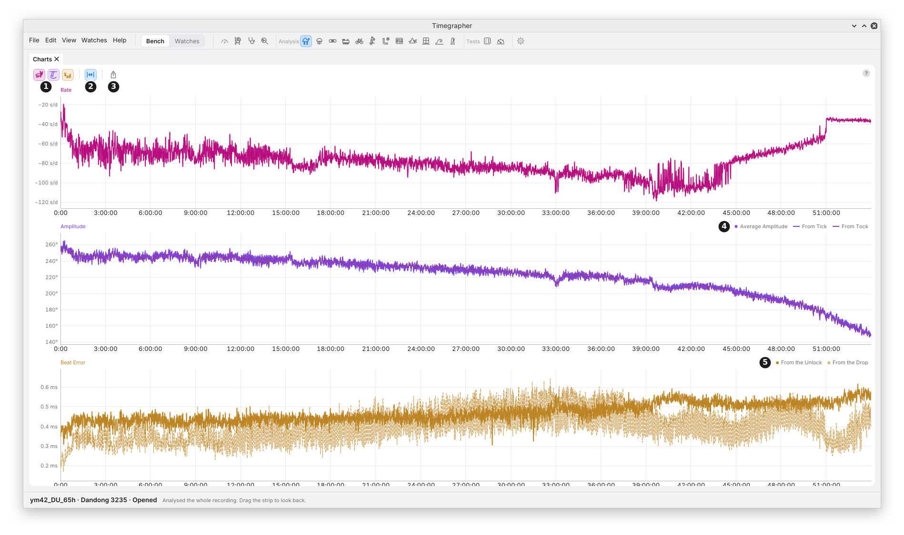
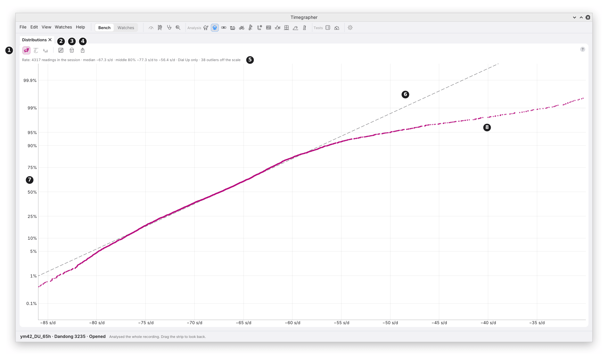

# 8. Charts and Distributions

Two panes look at the whole take, not just the last few seconds:

- **Charts** show each reading over time: rate, amplitude and beat error,
  from the take's start to its end.
- **Distributions** show how each reading's values spread, with time order
  left out.

Both open as tabs under the Paper Strip, from **Analysis** in the icon
bar. Distributions starts hidden.

## Charts

**What it shows:** one chart for each reading, stacked, all on the take's
time axis. 0:00 sits at the same place on every chart. With the Paper
Strip lying across, it sits at the same place on the strip too.

**Why you'd use it:** a card gives the last reading. A chart shows the
reading changing over the whole take, so you can see when something
happened: after a turn, at a knock, as the mainspring runs down.

| Mark | Control | What it does | Why you'd use it |
| --- | --- | --- | --- |
| 1 | **Rate**, **Amplitude**, **Beat Error** | Show or hide each chart. At least one stays on. The charts shown share the pane's height. | Fewer charts give each more height. |
| 2 | **Fit** | On while the charts show the whole take. A pan or a zoom turns it off; turning it on shows the whole take again. | To get back to the whole take after zooming in. |
| 3 | **Export** | Saves the pane as a picture, PNG or SVG. The chart keys go at the top in place of the toolbar. | To share the charts, or put them in a report. |
| 4 | The Amplitude key | **Average Amplitude**, solid, and the amplitude **From Tick** and **From Tock**, dashed. | To see whether the two sides read alike. |
| 5 | The Beat Error key | Beat error **From the Unlock**, solid, and **From the Drop**, fainter and dashed. | To compare the two measurements of beat error (M5). |

**The lines.** Each reading keeps its colour across the app: rate
magenta, amplitude violet, beat error amber. A second line of the same
reading is told apart by its dashes. Beat error is charted as a size, as
on its card.

**The scale** fits the lines on its own and holds every value, so no point
is drawn off the chart.

### Moving Around

| To | Do this |
| --- | --- |
| Read a moment | Point at it. A line marks that moment on every chart and on the strip. Each chart's top lane gives the time and every line's value there. |
| Pan | Scroll, swipe, or drag. Panning stops at the take's start and its latest reading. |
| Zoom time | Cmd or Ctrl and scroll, or pinch, around the pointer. |
| See the whole take | Double-click, or turn **Fit** on. While listening, the charts then follow new beats. |
| Find a moment on the strip | Click it. The strip and the readings go to it. |

All the charts pan and zoom together.

### What to Look For

| What you see | What it can mean |
| --- | --- |
| A step in all three charts at once | The watch changed state: a turn, a knock, a change of wind. Check the strip and the track at that moment. |
| Amplitude falling slowly over hours | The mainspring running down (chapter 21). |
| The rate following the amplitude | A rate that depends on the swing (isochronism, chapter 19). |
| From Tick and From Tock apart, but steady | The two sides sound different. It doesn't by itself mean the balance swings further one way (M4). |
| The two beat-error lines apart | The unlock and the drop give different beat errors (M5). |

### Good to Know

- **Changing Average Over or the lift angle** works every point out
  again, back to the take's start.
- **The charts always cover the whole take.** To look at a stretch, zoom
  in, or use the Paper Strip with its masks.
- **A pane too short for every chart** draws the first ones at a readable
  height and names the rest at its foot, such as "Beat Error not shown:
  no room".

## Distributions

**What it shows:** how the values of each reading spread over the take
in the position the watch is in now. A masked stretch is left out.

**Why you'd use it:** an average gives one number. A distribution shows
whether the watch keeps to one state or moves between two, such as a high
and a low amplitude, or a rate that jumps between two values.

### The Toolbar

| Mark | Control | What it does | Why you'd use it |
| --- | --- | --- | --- |
| 1 | **Rate**, **Amplitude**, **Beat Error** | Show or hide each reading's plot. At least one stays on. | Fewer plots give each more height. |
| 2 | **Show** | **Probability** (the default): probability paper. **Cumulative:** the share of values at or below each value. | Probability makes one steady state a straight line, so two states stand out. Cumulative reads directly as a share. |
| 3 | **Values** | **Readings** (the default): one value per Average Over, so no two share beats. **2 s:** one value per 2 s of beats. | Readings shows states that last longer than Average Over. 2 s catches quicker changes, with more scatter. |
| 4 | **Export** | Saves the pane as a picture, PNG or SVG. | |

### The Plot

| Mark | Part | What it shows |
| --- | --- | --- |
| 5 | The summary line | How many values, the median, the middle 80%, the one position counted, the outliers left off the scale, and the peaks when there is more than one. |
| 6 | The dashed line | Where the values would fall if they came from one steady state. It goes through the median, with a slope from the middle half of the values. |
| 7 | The percent scale | Each value's rank, spaced in standard deviations and labelled in percent. 50% is the median. |
| 8 | A value | One reading. In the picture, the lowest readings fall left of the line: a tail of slow readings. |

Hover the summary line to read it whole when the pane is narrow.

### Reading Probability Paper

On probability paper, each value is drawn against its rank, on a scale
spaced so that values from one steady state with random scatter fall on a
straight line. That makes departures from one state easy to see:

| The points | What it can mean |
| --- | --- |
| Along the dashed line | One steady state, with random scatter. |
| Two straight stretches joined by a bend | Two states: the watch spent part of the take at one level and part at another. |
| Flat through the middle, steep at both ends | Two states close together. |
| Both ends bending away from the line | One state with more large departures than random scatter gives, such as occasional disturbances or a slow wander. The Charts show which. |
| A few points off at one end | A few readings unlike the rest. The Charts show when they came. |

**Probability paper keeps no time order.** It shows that there were two
states, not when. The Charts and the strip show when.

### Good to Know

- **One position at a time.** Values from another position are a
  different measurement, so the plot counts only the position the watch
  is in now, and the summary line says so ("Dial Up only").
- **The scale leaves out the outermost 0.5% at each end,** so a stray
  value can't squeeze the rest together. The summary line counts them.
- **The beat error plot** says above it which measurement it uses (from
  the unlock or from the drop), and how many readings used it.
- **2 s values** are the finest the app measures. None reaches across a
  cut or into a masked stretch.

---

Previous: [The Tick Tock Profile and the Scope](07-profile-and-scope.md) ·
[Contents](README.md)
