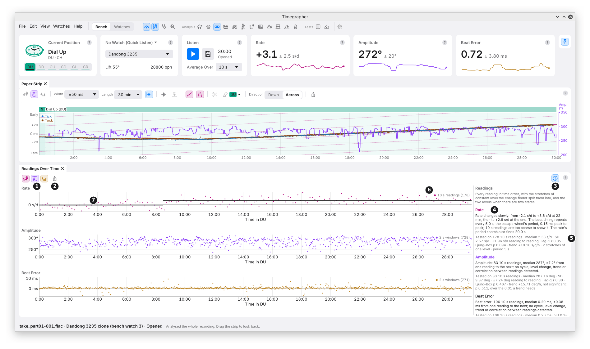

# 9. Steadiness: What It Is For, the Toolbar and Info

The readings cards give one number for each reading. The Charts show it
over time. **Steadiness** asks how it behaves over time: whether the rate,
the amplitude or the beat error holds one level, steps to another, drifts,
wanders, or repeats on a cycle. It runs a set of statistical tests on the
readings and shows what each one found.

It states what it finds, with the figures behind it. It doesn't say
whether that is good or bad for a watch: that is yours to judge.

## The Views

Steadiness has nine views. Each is a pane of its own, so two can sit side
by side. Their icons sit together under **Analysis** in the icon bar, and
in **View > Analysis**. They start hidden, as tabs beside the Tick Tock
Profile.

| View | Shows | Chapter |
| --- | --- | --- |
| **Readings Over Time** | Every reading in time order, with the stretches of constant level. | 10 |
| **Periods** | How strongly the readings repeat at each period. | 11 |
| **Cycle** | The readings folded at the cycle found, one cycle laid over the next. | 12 |
| **Autocorrelation** | How much each reading resembles the one a lag later. | 13 |
| **Allan Deviation** | How the scatter of an average changes as it gets longer. | 14 |
| **CUSUM** | The running sum of each reading's distance from the mean: steps in level. | 15 |
| **FFT** | The size of each period in the readings, like Witschi's FFT. | 16 |
| **STFT Map** | Each period's size over the take, read over 20 min windows. | 17 |
| **Wavelet Map** | Each period over the take, sharply placed in time. | 18 |

## The Toolbar and Info

| Mark | Control or part | What it does | Why you'd use it |
| --- | --- | --- | --- |
| 1 | **Rate**, **Amplitude**, **Beat Error** (the hare, the swing and the seesaw) | Show or hide each series in this pane. Rate alone at first; at least one stays on. | To compare the three, or give one the room. Each pane keeps its own choice. |
| 2 | **Export…** | Saves the pane as a picture, PNG or SVG. | |
| 3 | **Info** | Opens the Info panel down the right of this pane. It opens and closes only when clicked, and is one setting for every Steadiness view. | To read what the tests found, in words and figures. |
| 4 | A series' sentence | What was detected in that series, in one or two sentences: a cycle, two levels, a level change, a trend, correlation between readings, or none of these. | The headline: start here. |
| 5 | The statistics | What was tested ("Tested on 178 10 s readings"), the median, the standard deviation, the scatter from one reading to the next, the lag-1 correlation, the Ljung–Box p-value, and the trend and period when found. | The figures behind the sentence. |
| 6 | The key | What a dot is, and how many are drawn. | To know what is plotted: 10 s readings for the rate, 2 s windows for the amplitude and beat error. |
| 7 | A stretch | A level the change finder found (chapter 15). | To see where the level changed. |

Some views add their own switches to the toolbar: **dB Scale** (Periods
and the two maps), **Timing** (FFT) and **Wheel Periods** (Periods, FFT
and the two maps). Their chapters cover them.

The words in the Info panel can be selected and copied.

## What the Tests Read

- **The whole take, in the position on show.** Steadiness reads the
  position the watch is in now. When the take has several stretches in
  that position, they are joined end to end, and each join is a cut
  (M6).
- **Settled and unmasked.** Settling time and masked stretches are left
  out, as for the readings.
- **5 minutes at least.** The tests need 5 minutes of beats. While
  listening, they run again each time another minute has come in; an
  opened take is read once, in the background.
- **The same reading length for all three.** The rate is read in 10 s
  readings. The amplitude and the beat error are measured in 2 s windows;
  the windows inside each rate reading make one reading, their median.
  Cycles in the amplitude and the beat error are looked for in the 2 s
  windows, so a cycle there can be as short as 6 s.
- **No reading over part of its span.** A reading short of a window, or
  touching a cut or a mask, is left out, not averaged over what is left.
- **The beat error is the one from the unlock.** Where its sign turns
  over across a cut, its readings are drawn as sizes, and the Info panel
  says so.

## How Sure the Tests Are

Every test that gives a p-value (the period search, the Ljung–Box test,
the trend and the CUSUM) is held to one standard across all three series,
so running many tests on one take doesn't add up to a false alarm.

- A finding is named only when its own test passes, and also passes
  **Holm's correction** at 0.05 across the whole family of tests.
- On a steady watch, the tests aim to name nothing on 95 takes in 100.
  On the project's seeded steady takes they name nothing on 192 in 200.
- **Correlated readings** (each reading like the last, M7) raise the
  chance of a finding on short takes. On a 30 minute take whose readings
  follow each other closely, the tests named something on 30 takes in
  100. Takes of 2 hours or more stay near the target.

The thresholds are for detection: how sure a finding must be before it is
named. None of them is a tolerance for a watch.

## When You'd Use It

- **A rate that won't settle:** to tell drift, wander, a step and a cycle
  apart.
- **A periodic fault:** a cycle at a wheel's period points at that wheel
  (chapters 11 and 12).
- **After service or adjustment:** to see whether the readings now hold
  one level.
- **Long takes:** over hours, a slow change in amplitude or rate shows as
  a trend.

## What It Can't Tell You

- **The cause.** A cycle at the escape wheel's period says the readings
  repeat at that period; it doesn't say what is wrong with the wheel.
- **Anything faster than its readings.** 10 s readings can't show a
  change faster than 20 s. The rate's faster cycles come from the beat
  timing instead (chapter 11).
- **Anything in a short take.** 5 minutes is the least the tests run on.
  A cycle needs several turns inside the take to be found.

---

Previous: [Charts and Distributions](08-charts-and-distributions.md) ·
Next: [Readings Over Time](10-readings-over-time.md)
