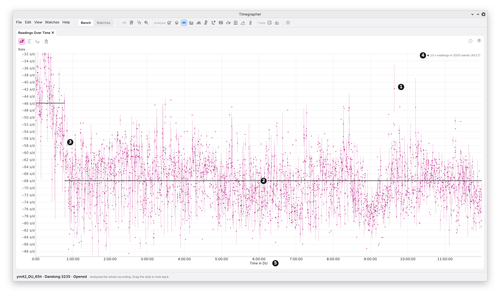

# 10. Readings Over Time

**What it shows:** every reading the tests read, in time order, with the
levels the tests found drawn over them.

**Why you'd use it:** it is the plainest view of what the other views
test. A step, a slide, two levels or a cycle that a test names should be
visible here, and so should the stray readings that a test is right to
look past.

| Mark | Part | What it shows |
| --- | --- | --- |
| 1 | A reading | One dot. For the rate, a 10 s reading; for the amplitude and the beat error, a 2 s window. On a long take, as here, a pale band from the lowest to the highest of a few readings, with a dot at their mean (below). |
| 2 | A stretch's level | A solid line at the mean of a stretch of constant level, from the change finder (chapter 15). Drawn when the tests name a level change, or a slide, which is drawn as its steps. |
| 3 | A change | Where one stretch ends and the next begins. In the picture the headline names one change: "Rate shifts level 1 time: -46.0 s/d, then -68.0 s/d." |
| 4 | The key | What a dot is, and how many are drawn: "10 s readings in 3000 bands (4317)". |
| 5 | The time axis | Time from the take's start. With positions marked, it is time in the position on show, its stretches joined end to end, and the axis says so ("Time in DU"). |

**In the picture** are the first 12 hours of the Dandong 3235 run-down
from chapter 8: 4317 rate readings. For the first 47 minutes after
winding the watch ran at about −46 s/d; then it settled to about
−68 s/d and held that level, with its scatter, for the next 11 hours.
An average over the first hour would read neither. The view shows the
change, where it came, and that nothing else changed level after it: the
dip near 9 hours comes back. A watch read on a timegrapher soon after
winding can read quite differently an hour later, and this is how to
see it.

**Two states.** When the tests find the readings flipping between two
levels, each level is drawn as a dashed line across the plot. The finder
names two levels only when they are well apart (at least two of their own
widths), each held at least a tenth of the time, with at least four
switches, and both seen in each third of the take, so a slow drift isn't
taken for two states.

**A long take** has more readings than the plot can show one by one. It
then draws each stretch of readings as a pale band from its lowest to its
highest, with a dot at its mean, and the key says how many bands and
readings: "10 s readings in 3000 bands (12000)".

**The scale** fits the readings, with a few stray ones left outside it.

## What to Look For

| What you see | What it can mean |
| --- | --- |
| One level, evenly scattered | A steady watch: nothing to name. |
| Two solid levels, one after the other | The level changed once: a knock, a change of wind, a change in the watch. The CUSUM (chapter 15) tests it. |
| A slow slope | A trend: the mainspring running down, or the watch warming. The Info panel gives its rate per hour. |
| Two dashed levels, flipping back and forth | Two states. In the amplitude, the balance swinging at two amplitudes in turn. |
| Readings rising and falling in a regular wave | A cycle. Periods and Cycle (chapters 11 and 12) find and measure it. |
| Readings that wander, without a pattern | Correlation between readings. Autocorrelation (chapter 13) measures it. |

## Good to Know

- **The headline names what the tests found,** not what the eye sees.
  A step that looks clear can go unnamed if the tests can't tell it from
  wander, and the Info panel then gives the figures without a name.
- **The amplitude and beat error dots are 2 s windows,** so they scatter
  more than the rate's 10 s readings. The tests read them as 10 s
  readings, as the rate is, and look for cycles in the 2 s windows
  (chapter 9).

---

Previous: [Steadiness](09-steadiness.md) ·
Next: [Periods](11-periods.md)
