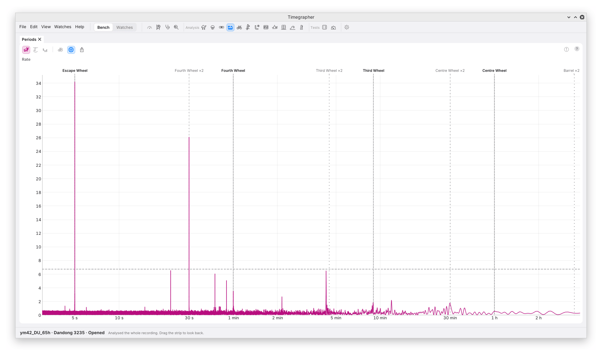

# 11. Periods

**What it shows:** how strongly the readings repeat at each period, from
seconds up to many minutes, on a log scale. A tall, narrow line is a
period the readings repeat at. The calibre's wheels' periods are marked
across it.

**Why you'd use it:** anything that turns with a wheel and disturbs the
beat once a turn shows here as a line at that wheel's period. This is where you look for a fault that comes and goes on a
regular beat.

## The Toolbar

| Mark | Control | What it does | Why you'd use it |
| --- | --- | --- | --- |
| 1 | **Rate**, **Amplitude**, **Beat Error** | Show or hide each series. | Rate alone at first. A fault at a wheel can show in one series and not another. |
| 2 | **dB Scale** | Draws the scores in decibels below the tallest, from 0 dB at the top down to −30 dB. Off: linear. | A small line beside a tall one still shows. |
| 3 | **Wheel Periods** | Marks the calibre's wheels' periods. On at first, and one setting for this pane only. | To match a line to a wheel. |
| 4 | **Export…** | Saves the pane as a picture. | |

## The Plot

| Mark | Part | What it shows |
| --- | --- | --- |
| 5 | The strongest line | Its period and, when it matches one, the wheel whose turn it matches: "5 s, Escape Wheel". |
| 6 | The dashed line | The score a period needs for the search to list it: its 1% false-alarm level over the whole search. |
| 7 | A wheel's period | A bold dotted line, named above the plot. |
| 8 | Half a wheel's period | A fainter dotted line marked ×2: where a wheel that is off centre shows, twice a turn. |
| 9 | Another line | A line over the dashed line that matches no wheel's period. |

With no calibre picked, or none of its wheels known, one minute and one
hour are marked in grey instead.

**In the picture,** the rate repeats every 5 s, the escape wheel's
period (it turns once in twice its teeth in beats: 20 teeth at
28,800 bph give 5 s, 15 teeth give 3.75 s), and the fourth wheel's minute shows as a line at 1 min with
taller ones at 30, 20 and 15 s: a half, a third and a quarter of a
minute. A disturbance that is sharp rather than smooth spreads over these
**harmonics** of its period, and they can stand taller than the period
itself.

## How It Is Worked Out

- **On the watch's own clock.** Each beat is placed at its number times
  the nominal beat period. A wheel turns once in a fixed number of beats
  (the fourth wheel every 480 beats at 28,800 bph), so on this clock its
  period is exact even when the rate changes.
- **Slow change taken off first,** with a running median over 30 minutes
  (a quadratic for takes under 20 minutes), so the mainspring running down
  isn't read as a long cycle.
- **Each period is scored with its harmonics,** its first 1, 2, 4 or 8,
  whichever scores best. A smooth cycle scores best on one; a short dip
  once a turn scores best on eight.
- **The strongest period is taken out and the search repeats,** so one
  fault isn't listed at several periods.
- **A line is listed** only when it passes the dashed 1% line, explains
  at least 0.5% of the variation, and passes Holm's correction across
  every test (chapter 9).
- **A line matches a wheel** when their periods agree to within 1%, or to
  the take's resolution (the period squared over the take's length),
  whichever is wider.

The rate is searched on the beats' timing, so its lines can be far
faster than the 10 s readings: the escape wheel's line is a swing in
the timing of the beats, given in ms, that no 10 s reading would show.
The amplitude and the beat error are searched on their 2 s windows, from
16 s up.

## What to Look For

| What you see | What it can mean |
| --- | --- |
| No line over the dashed line | Nothing repeats strongly enough to name. |
| A line at a wheel's period | The readings repeat once per turn of that wheel. |
| A line at half a wheel's period | Twice a turn: what an off-centre wheel can give. |
| Lines at a half, a third and a quarter of a wheel's period | A sharp disturbance once per turn of that wheel. |
| A line at no wheel's period | A repeat from something else: the room, the stand, or a wheel the calibre table doesn't list. |

## What It Can't Tell You

- **Which part is at fault.** A line at a wheel's period says the readings
  repeat with that wheel's turn; it doesn't say whether the wheel, its
  pinion or something turning with it is the cause.
- **Slow wheels in a short take.** A cycle needs several turns inside the
  take. The 5-minute takes show no line over the dashed line: five turns
  of the fourth wheel are too few to tell a cycle from slower wander.
- **Long periods.** Periods longer than about half the 30-minute running
  median are weakened by it, so a barrel's turn of hours isn't found here.
- **How big the swing is.** The score is how sure the search is, not how
  large the swing. The Cycle view (chapter 12) and the Info panel give
  the size.

---

Previous: [Readings Over Time](10-readings-over-time.md) ·
Next: [Cycle](12-cycle.md)
