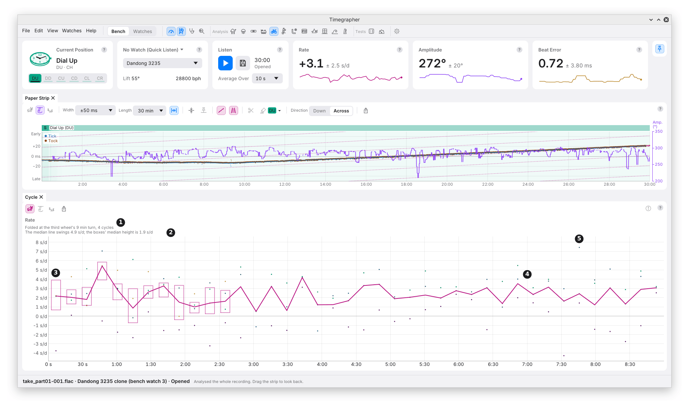

# 12. Cycle

**What it shows:** the readings folded at one period, so each cycle is
laid over the one before. Along the bottom is the time into the cycle,
from 0 to one period. The line is the cycle's typical shape.

**Why you'd use it:** Periods says the readings repeat at a period. Cycle
shows what one repeat looks like: a smooth wave, or a dip at one point in
the turn. It also shows how big it is, and whether it held through the
take.

| Mark | Part | What it shows |
| --- | --- | --- |
| 1 | What it is folded at | The period, and where it came from (below), with the number of cycles folded. |
| 2 | The swing | How far the median line swings, highest less lowest, beside the boxes' median height. |
| 3 | A box | The middle half of the readings at that point of the cycle. Drawn where a point has at least four readings. |
| 4 | The median line | The median reading at each point of the cycle: the cycle's typical shape. |
| 5 | A reading | One reading at its place in the cycle, coloured by when its cycle came: purple for the first, through to yellow-green for the last. |

**What it is folded at,** in this order:

1. **The series' own cycle,** when the tests found one or the period
   search listed one: "60 s cycle,
   Fourth Wheel, 30 cycles folded".
2. **Another series' cycle,** when this series has none: "Folded at the
   rate's 60 s cycle, 30 cycles". It then shows whether the same
   cycle is in this series too.
3. **The longest wheel's turn that fits,** when no series has a cycle:
   "Folded at the third wheel's 9 min turn, 4 cycles", as in the picture.

A period is used only when it is at least three readings long and the
take holds at least two turns of it.

## Reading the Swing

The note compares two sizes:

- **The swing of the median line:** how big the cycle is.
- **The boxes' median height:** how much the readings scatter at each
  point of the cycle.

A real cycle swings well clear of the scatter: the line's swing is large
beside the boxes' height, and the boxes follow the line. In the picture
the line swings 4.9 s/d against boxes 1.9 s/d high, but with only 4
cycles the line follows the scatter of a few readings. The tests found no
cycle in the rate's readings here, and the zigzag is that scatter.

## What to Look For

| What you see | What it can mean |
| --- | --- |
| A smooth wave, the boxes following it | A steady cycle through each turn. |
| A flat line with one dip or bump | A short event once a turn. |
| The same shape in every colour | The cycle held through the take. |
| The shape in early colours only | The cycle faded during the take. |
| A zigzag, boxes as tall as the swing | No cycle at this period: scatter. |

## What It Can't Tell You

- **Whether the cycle is real.** Folding draws a shape from any readings
  at any period. Whether the cycle is there is the period search's call
  (chapter 11) and the headline's.
- **A cycle faster than the readings.** The rate's readings are 10 s
  long; a cycle under 30 s is shown in Periods and the FFT from the beat
  timing instead.

---

Previous: [Periods](11-periods.md) ·
Next: [Autocorrelation](13-autocorrelation.md)
