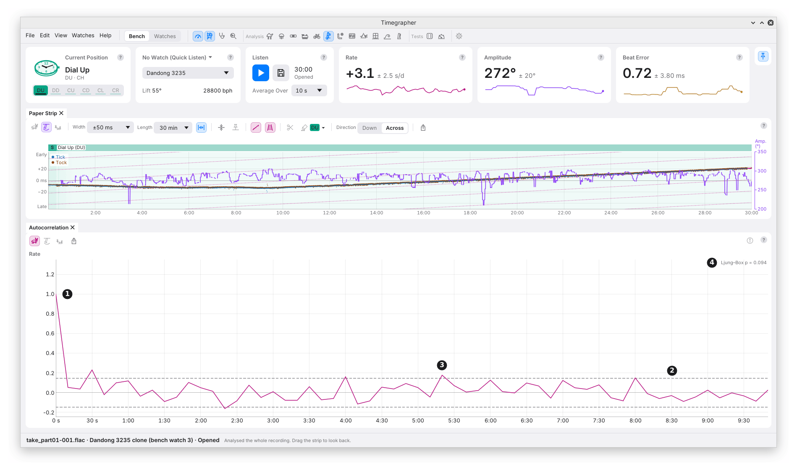

# 13. Autocorrelation

**What it shows:** how much each reading resembles the one a given time
later, the **lag**, from 0 up to 10 minutes. 1 is the same, 0 is no
resemblance, below 0 is opposite.

**Why you'd use it:** to know whether the readings are independent, each
one a fresh draw, or whether each follows the last. It also finds a
repeat that the period search may score too low to list.

| Mark | Part | What it shows |
| --- | --- | --- |
| 1 | Lag 0 | Every reading matches itself: always 1. |
| 2 | The band | The dashed lines at ±1.96/√n, n the number of readings; wider at a lag where gaps leave fewer pairs. Independent readings stay inside it at about 19 lags in 20. |
| 3 | A lag outside the band | A resemblance at that lag. One in twenty lags lands outside by chance. |
| 4 | The Ljung–Box p-value | One test over the first 10 lags together: the chance of resemblance this strong if the readings were independent. |

When the line falls and then rises back to a peak, the readings
**repeat**: the peak gets a dot and a note, "repeats at 60 s".

## How It Is Worked Out

- **Slow change taken off first,** with the same 30-minute running median
  as the period search (a quadratic for takes under 20 minutes), so a rate
  drifting as the mainspring runs down isn't counted as resemblance.
- **Corrected for that,** since taking the slow change off leaves a small
  negative resemblance of its own. Independent readings then read about 0
  at every lag.
- **Gaps are left as gaps.** Each lag is read from the pairs of readings
  that lag apart; a lag with under 30 pairs is left out.
- **The Ljung–Box test** weighs each of the first 10 lags by the pairs it
  is read from, and is judged against what independent readings of the
  same count, with the slow change taken off the same way, give.
- **The memory** in the Info panel is the lag where the resemblance falls
  below 1/e, about 0.37: how long a reading's resemblance lasts.

## What to Look For

| What you see | What it can mean |
| --- | --- |
| A drop to about 0 after lag 0, then inside the band | Independent readings: each one a fresh draw. As in the picture. |
| A slow fall over several lags | Each reading follows the last: the watch wanders. The ± allows for it (M7). |
| A fall and a rise to a peak | The readings repeat at the peak's lag. |
| A Ljung–Box p under 0.05 | Resemblance across the first 10 lags, beyond chance. The headline names it only if it also passes Holm's correction (chapter 9). |

In the picture, the rate's readings are close to independent: a few lags
touch the band, and the Ljung–Box p is 0.094.

## What It Can't Tell You

- **Why the readings follow each other.** Wander in the watch, a changing
  temperature and a slowly changing sound all give the same slow fall.
- **A repeat faster than two readings.** Lags step by one reading, 10 s
  for the rate.

---

Previous: [Cycle](12-cycle.md) ·
[Contents](README.md)
