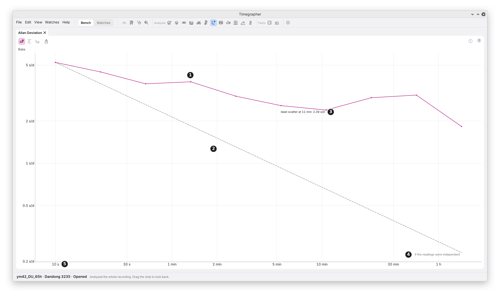

# 14. Allan Deviation

**What it shows:** how much the average of the readings scatters as the
average gets longer. Along the bottom is the **averaging time**, τ (tau);
up the side, the scatter of averages that long, in the series' own unit.
Both axes are logarithmic. Lower is steadier.

**Why you'd use it:** to find out whether averaging longer actually helps.
For a watch whose rate only jitters from one moment to the next, a longer
average is always steadier. For one that wanders, drifts or cycles, it
stops helping past some averaging time, and the curve shows where. It is
the standard way clocks and oscillators are compared for stability (M9).

| Mark | Part | What it shows |
| --- | --- | --- |
| 1 | The Allan deviation | A dot for the scatter of averages at each averaging time, joined by a line: 10 s, 20 s, 40 s and so on, doubling, while the take holds at least 3 independent pairs of averages that long. |
| 2 | The dashed line | What independent readings would give: the scatter at one reading divided by √(τ ÷ one reading). It falls by half for every fourfold longer average. |
| 3 | Least scatter | The averaging time with the smallest scatter, and that scatter: the most repeatable average this take gives. Picked only among times with at least 8 independent pairs. |
| 4 | The dashed line's label | "if the readings were independent", where the line ends. |
| 5 | The averaging time | τ, from one reading (10 s) up. |

## How It Is Worked Out

- **On the 10 s readings,** for all three series (chapter 9).
- **Overlapping averages.** For each averaging time, every run of
  readings that long is averaged, starting at every reading, and each
  average is compared with the next one along. The Allan deviation is
  √(½ × the mean squared difference). M9 gives the formula.
- **Only whole averages.** An average counts only when every reading in
  it is there; one touching a gap or a cut is left out, not averaged over
  what is left.
- **How many pairs.** Overlapping averages share readings, so the count
  that sets how far the curve goes is the independent pairs: the pairs
  divided by the readings in an average. The curve stops when that falls
  under 3.

## What to Look For

| What you see | What it can mean |
| --- | --- |
| The curve on or below the dashed line all the way | The readings jitter from moment to moment and nothing more. A longer average is always steadier. |
| The curve leaves the dashed line and flattens | The readings wander: past that time, averaging longer doesn't help. As in the picture, from the first average. |
| The curve rises towards the right | Drift or slow wander: the longer the average, the more it differs from the next. |
| A bump | A cycle. A cycle of period P lifts the curve near 0.37 P. |

**In the picture** are the first 12 hours of the Dandong 3235 run-down
from chapter 8. Single 10 s readings scatter by about 5 s/d. Were they
independent, an hour's average would scatter by about 0.3 s/d, the
dashed line. Instead the curve leaves the line at once and hardly falls:
the least scatter is 2.39 s/d, for averages of 11 minutes, and averages
of 20 to 40 minutes scatter more again, about 3 s/d, lifted by the slow
changes Readings Over Time shows (chapter 10). What it means at the
bench: on this watch, two readings taken one after the other, each
averaged over 11 minutes, differ by about 3.4 s/d (root mean square,
√2 × 2.39), and averaging longer doesn't narrow that: over 20 to
40 minutes they differ by about 4 s/d.

**In the Info panel,** when the curve stands at least twice the dashed
line at any averaging time with 8 or more independent pairs, the tests
count the readings as wandering. When no cycle, level change, trend or
two states lead the headline, it then names the readings as correlated,
and says how far the curve stands: "Allan deviation up to 2.3× what
independent readings give".

## What It Can't Tell You

- **Which of wander, drift or a cycle it is.** All three lift the curve.
  Readings Over Time, CUSUM and Periods tell them apart.
- **Anything at long averaging times in a short take.** The curve stops
  where too few independent pairs are left: at most a fifth of the take.
- **The cause.** Wander in the watch, a temperature change and a changing
  contact on the stand all lift the curve alike.

---

Previous: [Autocorrelation](13-autocorrelation.md) ·
Next: [CUSUM and Change Points](15-cusum-and-change-points.md)
