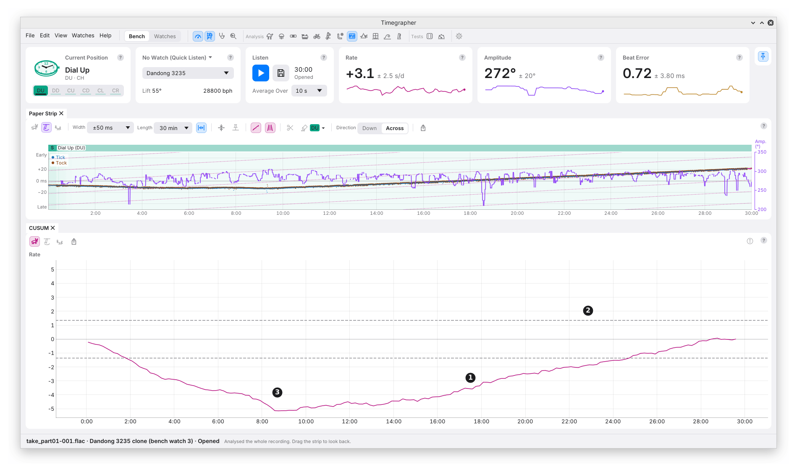

# 15. CUSUM and Change Points

**What it shows:** the **CUSUM**, the cumulative sum: the running total of
each reading's distance from the mean of all of them, scaled so that the
same lines hold for any take. With no change of level the total wanders
about 0. Where the level changes, it turns.

**Why you'd use it:** to tell whether the level of a series changed during
the take, and when. A step of a fraction of the scatter is hard to see in
the readings themselves; the running total adds it up reading after
reading until it stands out. It is how you check a knock, a change of
wind or a change in the watch that you suspect moved the rate.

| Mark | Part | What it shows |
| --- | --- | --- |
| 1 | The CUSUM | The running total, against the time of the take. |
| 2 | The dashed lines | ±1.36: readings with no change of level, correlated or not, stay inside them about 95 times in 100. |
| 3 | The largest excursion | The point furthest from 0. When the headline names a level change, the corner nearest it gets a dot and a note, "level changes near 12:30". |

## Reading the Shape

The total goes down while the readings are under the mean and up while
they are over it. So:

- **A V or an upturned V** (a tent) is a step: under the mean, then over
  it, or the reverse. The corner is where the level changed.
- **A smooth bowl or dome** is a slide: the level moving gradually, not
  in one step.
- **A wander inside the lines** is no change of level.

**In the picture,** the total falls to −5 at about 9 minutes, then rises
back to 0: the rate was under its mean for the first part of the take and
over it for the rest. The headline names a slide, "Rate changes slowly",
not a level change, so no corner is marked; Readings Over Time draws the
slide as its two steps (chapter 10).

## Change Points

The **change finder** splits the readings into stretches of constant
level. Its stretches are what Readings Over Time draws, and their number
is in the Info panel.

- It reads **30 s block medians,** so one stray reading doesn't make a
  stretch.
- It splits the take at the best place, then splits each part again, as
  long as each stretch is at least **5 minutes** long.
- A split is kept only when it is strong evidence against one level: its
  gain must beat 3 × the log of the number of blocks, and never less than
  15 (M9).

The finder only places the cuts. Whether the level changed is the
CUSUM's call.

## When a Level Change Is Named

The headline names a level change, and the CUSUM marks its corner, only
when all of these hold:

- the change finder cut the readings;
- the CUSUM's own test passes: the chance of an excursion this large with
  no change of level is under 0.01;
- that test also passes **Holm's correction** across every test of the
  take (chapter 9);
- the stretches explain at least a fifth of the readings' variation;
- a slide doesn't explain the readings as well or better.

A step that only the CUSUM shows still bends the line; it just isn't
named.

## How It Is Worked Out

- **Distance from the mean,** summed from the first reading to each one.
- **Scaled by σ√n,** n the number of readings and σ their **long-run
  scatter**: the scatter from one reading to the next, allowing for how
  much each reading follows the last (M7). The correlation is read once
  the largest step is taken out, so a real step can't hide itself by
  widening the scale.
- **The ±1.36 lines** come from the Kolmogorov distribution: the largest
  excursion of a running total of independent noise stays under 1.36 on
  95 takes in 100. The CUSUM's p-value is that distribution's tail at the
  largest excursion. M9 gives the formula.

## What to Look For

| What you see | What it can mean |
| --- | --- |
| The line inside the dashed lines | No change of level. |
| A V or a tent past the lines, the corner marked | A step in the level: the note says when. |
| A bowl or a dome past the lines | A gradual change: a slide or a trend. |
| Several corners | Several steps: the stretches are in Readings Over Time. |

## What It Can't Tell You

- **The size of the step.** The CUSUM's height is in units of scatter, not
  s/d. The stretches' levels are in Readings Over Time and the Info panel.
- **The cause.** A knock, a change of wind, a temperature change and a
  change in the stand's contact give the same shape.
- **A change in the last or first few minutes.** Stretches are at least
  5 minutes long.

---

Previous: [Allan Deviation](14-allan-deviation.md) ·
Next: [FFT](16-fft.md)
