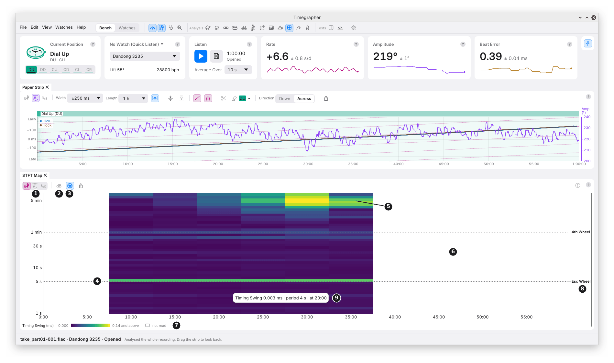

# 17. STFT Map

**What it shows:** the size of each period's swing at each time of the
take. Up the side is the period, on a log scale, the longest at the top;
across is the time of the take. Each cell's colour is the size, from dark
purple for the smallest to yellow for the largest. It is made from the
**short-time Fourier transform** (STFT): the spectrum of each 20 minutes
of readings, stepped 5 minutes.

**Why you'd use it:** the FFT (chapter 16) reads the whole take at once,
so a swing that came and went, or one that drifted in period, is blurred
into one figure. The map shows when it was there and how big it was then.
Every period is read over the same 20 minutes, so sizes compare fairly
from one row to the next. Use it to see whether a wheel's swing held
through a take, grew as the mainspring ran down, or stopped after a
knock.

The picture is the first hour of a 7-hour take on another watch with the
same calibre: the 30-minute take of chapters 9 to 16 is too short.

## The Toolbar

| Mark | Control | What it does | Why you'd use it |
| --- | --- | --- | --- |
| 1 | **Rate**, **Amplitude**, **Beat Error** | Joined into one control: the map shows one series at a time, Rate first. The Wavelet Map shares the choice. | The map needs the pane's room. Switching between the two maps keeps the same series. |
| 2 | **dB Scale** | Colours the sizes in decibels below the brightest, over the map's own range of up to 300 to 1, so the key reads from 0 dB down to about −50 dB at most. This map only. | A weak line beside a strong one still shows. |
| 3 | **Wheel Periods** | Marks the calibre's wheels' periods across the map. On at first; this pane only. | To match a line to a wheel. |

## The Map

| Mark | Part | What it shows |
| --- | --- | --- |
| 4 | A line across | A swing at one period that holds through the take. Here the escape wheel's 5 s, in every window. |
| 5 | A bright patch | A swing that comes and goes. Here at periods of about 3 to 7 minutes, in the windows centred from 25 to 35 minutes: the beat timing wandering slowly. |
| 6 | An empty area | Not read. Each column is one 20-minute window, drawn 5 minutes wide at its middle; a window with any reading missing is left empty. Here a gap near 49 minutes empties every window that holds it. |
| 7 | The key | What the colour measures and its unit: **Timing Swing (ms)** for the rate's map, **Amplitude Swing (°)**, **Beat Error Swing (ms)**. From 0 up to the size 99.5% of the cells read stay under, which the brightest colour shares with every size above it. |
| 8 | A wheel's name | Short names in a lane right of the map, level with their lines: **4th Wheel**, **Esc Wheel**. The pointer on a wheel's line gives its full name and period, "Escape Wheel, 5 s". |
| 9 | A cell under the pointer | Its size with its unit, its period and its time: "Timing Swing 0.003 ms · period 4 s · at 20:00". |

**The rate's map is of the beat timing,** in ms, not of the rate in s/d:
a swing of the timing at 5 s is far too fast for any rate reading to
show (chapter 16).

## How It Is Worked Out

- **Windows of 20 minutes, stepped 5 minutes,** each with every reading
  present. A window holding a gap, a cut or a mask is left out; nothing
  is filled in.
- **In each window,** the straight line through the readings is taken
  off and a Hann window applied, then the spectrum is read.
- **48 periods,** evenly spaced on the log scale, from 4 readings (1 s
  for the rate's timing, 8 s for the amplitude and beat error) up to a
  third of the window, 400 s. Each row reads the strongest frequency in
  its band, halfway to the rows either side, so a line between two rows
  still reads within 20% of its size.
- **Sizes** are the sine's size at that period, half its peak to peak, as
  in the FFT.

M11 explains the method and its trade-offs.

## What to Look For

| What you see | What it can mean |
| --- | --- |
| A line across at a wheel's period | That wheel's swing, steady through the take. |
| A line that fades or brightens | A swing that weakens or grows: with the mainspring, the temperature or a change in the watch. |
| A line that starts or stops | Something that began or ended: a knock, a change of position, a part settling. |
| A line that slopes | A period that changes. A wheel's period is fixed on the watch's own clock, so a sloping line is from something that doesn't turn with the beat, such as the room or the stand. |
| Bright cells at the longest periods | Slow wander in the series. |

## What It Can't Tell You

- **Anything in a short take.** It needs 20 minutes of readings with none
  missing, and a pane with less says so.
- **Exactly when.** Each column is 20 minutes of readings; a change shows
  over that span, not at its moment. The Wavelet Map (chapter 18) places
  short periods more sharply.
- **Periods over 400 s.** A slower wheel's turn is beyond a third of the
  window: it is in the FFT and the Wavelet Map.
- **Whether a line is real.** That is the period search's call
  (chapter 11).

---

Previous: [FFT](16-fft.md) ·
Next: [Wavelet Map](18-wavelet-map.md)
