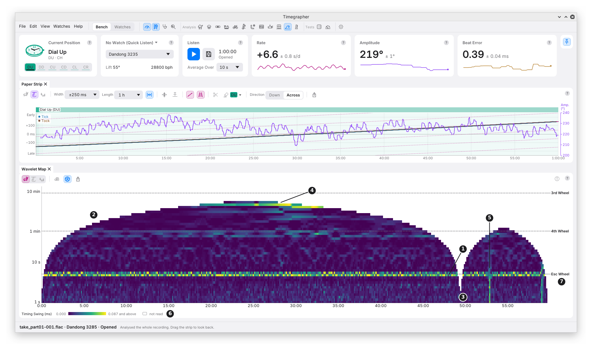

# 18. Wavelet Map

**What it shows:** like the STFT Map (chapter 17), the size of each
period's swing at each time of the take: period up the side, on a log
scale, time across, size as colour. It is made from a **wavelet
transform**. A wavelet is a short burst of a wave, a few swings long;
the transform slides one along the readings at each period, stretched
to fit, and records how well it matches. So it reads each period over
a time to suit it: short periods over a short time, long ones over a
long time.

**Why you'd use it:** to see sharply **where and when** a swing is. A
fast swing is placed to within seconds, not to within a 20-minute window,
and each swing is sharpened towards its true period. It also reaches
longer periods than the STFT Map, up to an hour. Use it to find the
moment a swing started or stopped, or a brief event, and the STFT Map to
read how big a swing is.

The picture is the same hour as chapter 17's.

The toolbar is the STFT Map's (chapter 17): the series, chosen together
with the STFT Map, **dB Scale** for this map, **Wheel Periods** and
**Export…**. The pointer over a cell gives its size, period and time.

| Mark | Part | What it shows |
| --- | --- | --- |
| 1 | A line across | A swing at one period through the take: here the escape wheel's 5 s, in both stretches. |
| 2 | The empty edge | Not read. Near each end of a stretch, a period's wavelet would reach past the readings, so the cells there are left empty. Long periods need more room, so the read area is a dome: its **cone of influence**. |
| 3 | A gap | A break in the readings: each unbroken stretch is read alone, with its own dome. Here near 49 minutes. |
| 4 | Bright cells at long periods | A slow swing: here the beat timing wandering over several minutes, in the same place as the STFT Map's bright patch. |
| 5 | A stripe up the map | Something brief that touched every short period at once. |
| 6 | The key | As the STFT Map's: **Timing Swing (ms)** for the rate's map, from 0 up to the size 99.5% of the cells read stay under. |
| 7 | A wheel's name | The wheels' short names, level with their lines. |

## How It Is Worked Out

- **A Morlet wavelet** (a short wave inside a bell-shaped envelope) is
  slid along the readings at each period. Its length grows with the
  period, so every period is read over the same number of its own turns.
- **Synchrosqueezed:** each value is moved to the period its own phase
  turns at, which pulls a spread-out line in towards its true period.
- **Each unbroken stretch alone,** of at least 64 readings. Nothing is
  read across a gap.
- **Periods up to an hour,** or a quarter of the longest unbroken
  stretch, whichever is shorter, from 4 readings up. A very long stretch
  is averaged down first, to keep the work bounded.
- **Sizes** are a sine's size, half its peak to peak. Under noise the
  sharpening spreads a line over neighbouring rows, so one row reads
  less than the line's size: read the size from the STFT Map.

M11 explains the method and its trade-offs.

## What to Look For

| What you see | What it can mean |
| --- | --- |
| A line across at a wheel's period | That wheel's swing, through the take. |
| A line that breaks off or starts | A swing that stopped or began: the map says when to within a few of its turns. |
| A stripe up the map | A brief event: a knock, a noise in the room, a missed beat. |
| Bright cells at the top | Slow wander or drift in the series. |
| An empty map, "needs a longer stretch of unbroken readings" | No stretch is long enough: too many gaps. |

## STFT Map or Wavelet Map?

| You want | Use |
| --- | --- |
| How big a swing is | The STFT Map: every period read over the same 20 minutes. |
| When a swing started, stopped or changed | The Wavelet Map. |
| A brief event | The Wavelet Map. |
| Periods over 400 s | The Wavelet Map, or the FFT. |

## What It Can't Tell You

- **The size, closely.** Under noise one row reads under the line's size.
- **Anything near a stretch's ends at long periods:** the cone leaves
  them empty.
- **The cause of a stripe.** A knock, a noise and a missed beat look alike.
- **Whether a line is real.** That is the period search's call
  (chapter 11).

---

Previous: [STFT Map](17-stft-map.md) ·
Next: [Isochronism](19-isochronism.md)
