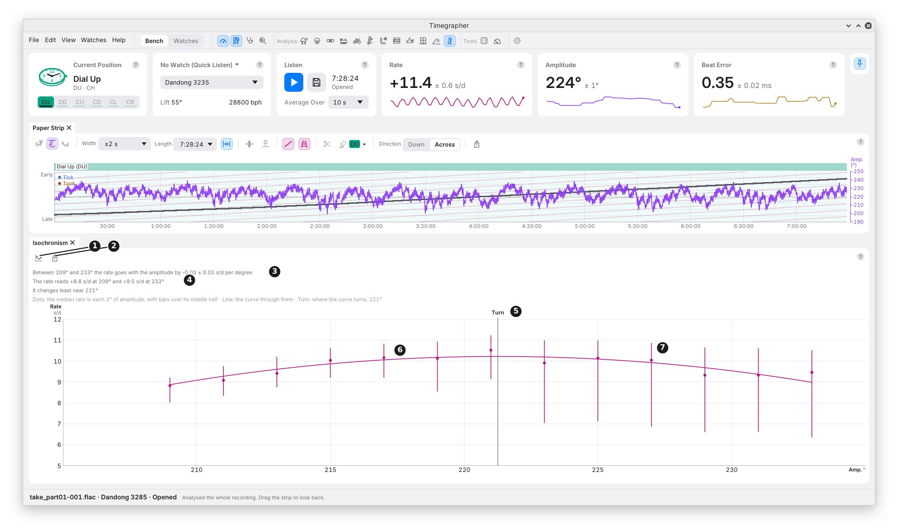
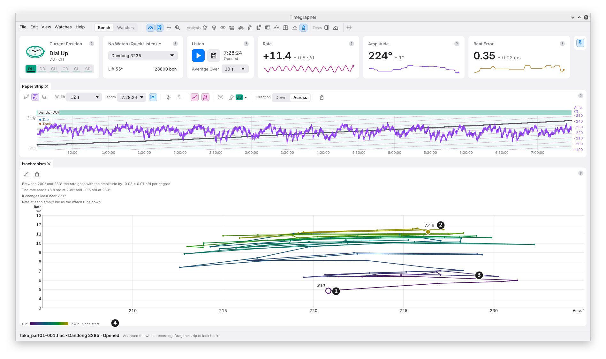

# 19. Isochronism

**What it shows:** the rate at each amplitude. As the mainspring lets
down, the balance swings less, and a watch's rate moves with it. The pane
sorts the take's 10 s rate readings by the amplitude of the same reading,
2° at a time, and shows the rate in each step and the curve through
them.

**Why you'd use it:** a balance that kept the same rate at every
amplitude would be **isochronous**. None is quite, and how far the rate
moves as the amplitude falls is what decides how the watch keeps time
through a day's wind. Use it on a run-down, or on any take that covers a
wide range of amplitude, to see how much the rate moves per degree and
at which amplitude it changes least. After an adjustment to the
hairspring, the balance or the escapement, compare it with a take from
before.

The picture is a whole 7 h 28 min take of a Dandong 3285 in Dial Up,
fully wound at the start, opened in the app.

| Mark | Part | What it does or shows |
| --- | --- | --- |
| 1 | **View** | **Curve** (this view) or **Walk** (below). Kept between runs. |
| 2 | **Export…** | Saves the pane as a picture, PNG or SVG. |
| 3 | The slope | "Between 209° and 233° the rate goes with the amplitude by −0.03 ± 0.01 s/d per degree": a straight line through every reading. |
| 4 | The ends | The median rate in the lowest and the highest 2° step. |
| 5 | Where it changes least | The amplitude where the curve turns, when that is inside the range. A vertical line marks it. |
| 6 | A dot and its bar | The median rate in one 2° step of amplitude, and a bar over the middle half of its readings. |
| 7 | The curve | A quadratic through the dots, each weighted by its readings. |

**In the picture,** the straight line through every reading gives
−0.03 ± 0.01 s/d per degree, yet the end steps read +8.8 s/d at 209° and
+9.5 s/d at 233°. The curve shows why: the rate rises to about +10 s/d
near 221° and falls on either side, so one slope sums it up poorly. That
is why the pane gives the curve and the turn beside the slope.

## The Walk View

**Walk** keeps the time the curve leaves out: one dot for each 5 minutes,
at its median rate and its median amplitude, in time order, joined by a
trail. Each dot is coloured by the hours since the take's start, with a
key. A ring marks the start, a large dot the end with its hour, and a
ring each 12 hours (each 24 hours on a take over 96 hours). The trail
breaks where a stretch was left out or the take broke. The pointer on a
dot gives its time and figures.

| Mark | Part | What it shows |
| --- | --- | --- |
| 1 | The start | A ring at the first 5 minutes, labelled "Start". |
| 2 | The end | A large dot at the last, with its hour: "7.4 h". |
| 3 | The trail | Dot to dot in time order, shading from each dot's colour to the next's. |
| 4 | The key | The colours from 0 h to the take's end, "7.4 h since start". |

**In the picture,** the rate climbs from about +5 s/d at the start to
about +11 s/d at the end, purple to yellow, while the amplitude moves
back and forth over 215° to 231° from one 5 minutes to the next. The
Curve view sorts those same readings by amplitude and so hides the climb.

Use it to see the path the watch took: a steady walk down in amplitude,
a step after a knock, or a return to where it was. Both views span the
same amplitudes, so a degree stays put when you switch.

## How It Is Worked Out

- **Rate against amplitude, reading by reading.** Each 10 s rate reading
  is paired with the amplitude of its own 2 s windows.
- **Steps of 2°,** each needing at least 10 readings, between the 2nd and
  98th percentile of the amplitudes, so a few stray readings don't add
  steps of their own. At least 3 steps are needed.
- **The slope** is a straight line through every reading, none smoothed,
  corrected for the noise in the amplitude readings, with a ± that allows
  for correlated readings. It is withheld when that noise is half or more
  of their spread. M12 gives the method.
- **The turn** is where the quadratic is flattest, given when it falls in
  the middle 80% of the range.
- **The walk** takes the median rate of the 10 s readings and the median
  amplitude of the 2 s windows in each 5 minutes; a 5 minutes with under
  half of either is left out, never filled.

## What to Look For

| What you see | What it can mean |
| --- | --- |
| A flat curve | The rate barely moves with the amplitude over this range. |
| The rate rising as the amplitude falls | The watch gains at low amplitude. |
| The rate falling as the amplitude falls | The watch loses at low amplitude. |
| A turn inside the range | The amplitude where the rate is least sensitive. |
| A walk that doubles back | The amplitude rose again: a wind, or a change in the stand or the watch. |

## What It Can't Tell You

- **The cause.** The slope says the rate and the amplitude went together.
  Anything else that changed over the take, the temperature or the
  position, moves with them.
- **Much on a short take.** Over a few degrees, the curve is mostly
  noise. It is made for a run-down of many hours.
- **A mix of positions.** A take in several positions mixes them, and the
  pane says so.
- **The wheel cycle.** A cycle of a few minutes that moves the rate and
  amplitude together is in the Steadiness views (chapters 11 and 12), not
  here.

Until there are 5 minutes of beats in one position, the pane says so.
The **?** in its toolbar gives what it needs.

---

Previous: [Wavelet Map](18-wavelet-map.md) ·
Next: [Positions Test](20-positions-test.md)
