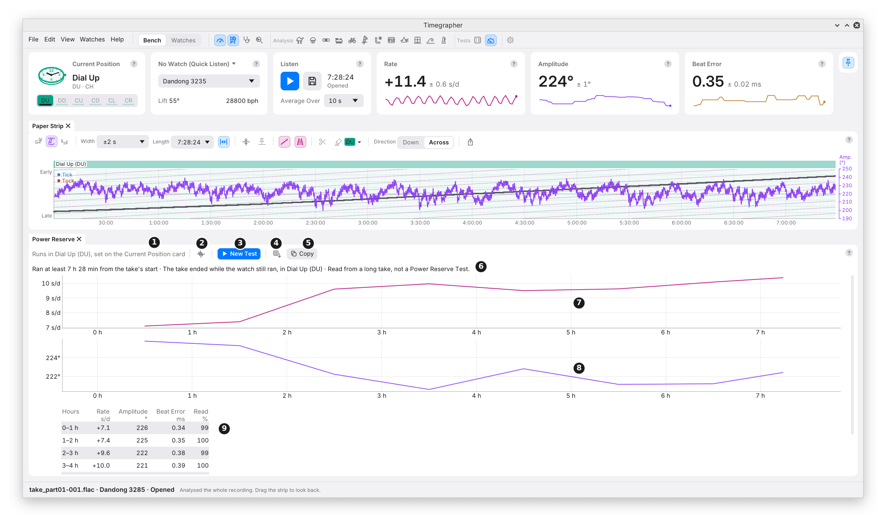

# 21. Power Reserve Test

**What it shows:** how long the watch runs from full wind until it stops,
in one position, and how its rate, amplitude and beat error change hour
by hour on the way.

**Why you'd use it:** the power reserve is how long a full wind lasts.
A watch that stops well short of its calibre's figure, or whose amplitude
falls away early, can point to the mainspring, its lubrication or the
barrel. The hour table also shows how the rate moves as the mainspring
lets down, the same thing Isochronism (chapter 19) reads by amplitude.

The Power Reserve pane is a hidden tab beside the Positions Test, its
icon a fuel gauge near empty, under **Tests** in the icon bar and the
View menu.

## The Toolbar

| Mark | Control | What it does | Why you'd use it |
| --- | --- | --- | --- |
| 1 | The position | "Runs in Dial Up (DU), set on the Current Position card". The test runs in the position on that card; the pane has no position setting of its own. | Set the position on the card before you start. |
| 2 | **Keep Sound** or **Analysis Only** | Keep Sound keeps the run's sound in the take. Analysis Only keeps its analysis alone, and deletes the sound, as Keep Analysis Only does (chapter 23). | A run of 40 hours or more is a large file. The pane's hover before a test gives the space free against the most an 80-hour run writes: 0.35 GB an hour at 48 kHz, 16-bit. |
| 3 | **New Test** | Sets the test up on a clear Bench and starts nothing. **Cancel Test** then takes its place. | To start a run. |
| 4 | **Save as CSV…** | Saves the watch, the run and the hour table, with a "Beat error from" column. | For a spreadsheet or a service record. |
| 5 | **Copy** | The same, on the clipboard, with tabs between the columns. | To paste into a note or a message. |

## Running a Test

1. Wind the watch fully and set its position on the Current Position
   card.
2. **New Test**, then **Start Test** on the Listen card. A new session
   starts in that position.
3. Leave it. While the test runs, the computer is kept awake, whatever
   Keep Awake is set to, and the position can't change. The pane shows
   the run time from the first beat heard, how the beats stand, and the
   stops on the way, with the hours so far.
4. The test ends by itself when the watch stops. **Stop Test…** on the
   Listen card ends it early, after asking, with **Keep Measuring** the
   default.

**When the watch has stopped:** the run ends at the last beat heard
before 10 minutes with none. A beat counts when it matches the watch's
sound with a quality over 0.4, in a run of at least eight such beats each
within one and a half beats of the last, so a lone click is not the
watch. Beats that come back sooner join the run, and each silence of 30 s
or more inside it is counted as a stop on the way. A run still going at
80 hours ends there.

The take is kept in the watch's history, named by its local start time
and "Power Reserve". The Watches view lists it as "Power Reserve 46 h
12 min", adding how it ended when the watch didn't stop it: "Stopped by
hand while the watch still ran", or "Reached the 80 h limit while the
watch still ran".

## The Results

| Mark | Part | What it shows |
| --- | --- | --- |
| 6 | The result line | The run time in true time (through the sound card's measured clock), how it ended, and the position: "Ran 41 h 12 min · The watch stopped, in Dial Up (DU)". |
| 7 | The rate | The rate against hours since the first beat, a point for each whole hour. |
| 8 | The amplitude | The amplitude against the same hours. |
| 9 | The hour table | Each hour: its rate (s/d), median amplitude (°), beat error (ms) from the unlock, and how much of the hour its whole 10 s readings cover (Read %). The last hour is as long as is left. |

A beat error from the drop, where the unlock isn't found, is drawn dimmed,
with a key over the table, and each beat error's hover names its source.
Scrolled down, the table's titles stay at the top.

While a test runs, about once a minute the hour in progress is measured
again, and it shows as a finished run's last would, "2 h + 26:28". The
charts start from the first whole hour.

## From a Long Take

A take opened whole that isn't a Power Reserve Test, in one position,
with six hours or more from its first beat to its last, fills the pane
the same way, as in the picture. Its wind at the start isn't known, so
its run is never called a power reserve: the line reads "Ran at least
7 h 28 min from the take's start" and "Read from a long take, not a Power
Reserve Test". Nothing is written into the take.

**In the picture,** over the first four hours of a fully wound watch, the
rate climbs from +7.1 to +10.0 s/d while the amplitude falls from 226° to
221°.

## What to Look For

| What you see | What it can mean |
| --- | --- |
| A run well short of the calibre's power reserve | The mainspring, its lubrication, the barrel, or a wind that wasn't full. |
| The amplitude falling steadily, then faster near the end | The mainspring letting down; the last hours have the least power. |
| The rate moving as the amplitude falls | The watch's isochronism (chapter 19). |
| Stops on the way | Silences of 30 s or more: the watch stopping and starting, or the sound lost. |
| A low Read % in an hour | Little of that hour could be read: noise, or a weak sound late in the run. |

## What It Can't Tell You

- **The cause** of a short reserve. The run time and the amplitude say how
  it ran down, not why.
- **The calibre's rated reserve.** Compare with the maker's figure; the
  app gives what this watch did.
- **Other positions.** A test runs in one position. A Positions Test
  (chapter 20) compares positions.
- **A wind it didn't see.** A run from a long take starts wherever the
  take started, not at full wind.

---

Previous: [Positions Test](20-positions-test.md) ·
[Contents](README.md)
