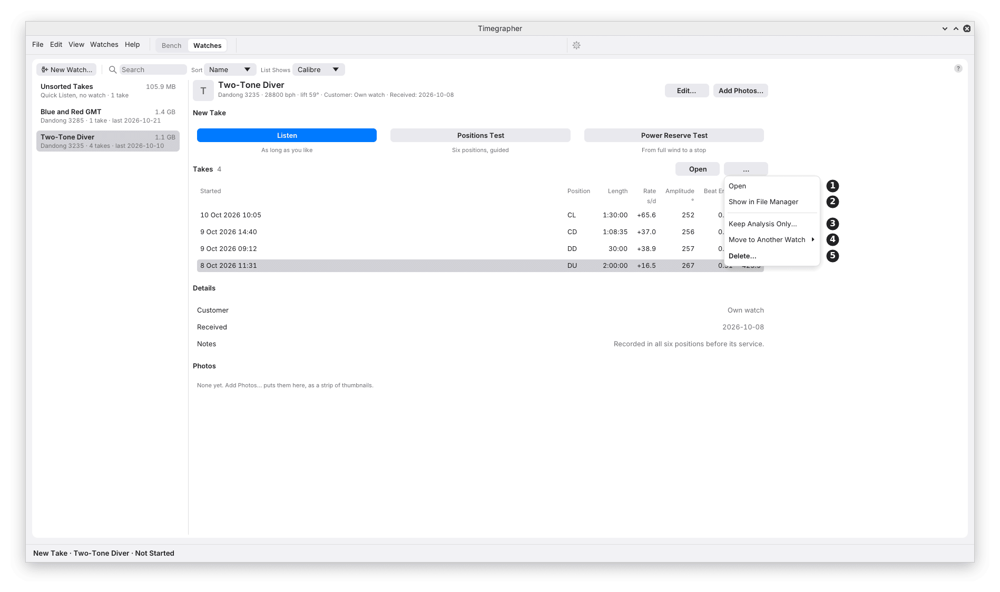

# 23. Takes and Sound Files



**What it covers:** what a take is on disk, how it is kept as it is
heard, how to open a recording made elsewhere, and how to keep a long
take's readings without its sound.

**Why you'd use it:** a take holds the sound itself, not just the
figures, so it can be read again later by a newer app, checked from the
command line, or sent with a problem report. Knowing where it is and
what is in it lets you back it up, move it, or free the disk without
losing what matters.

## Keeping a Take

Chapter 2 ([Stop and Save](02-your-first-take.md#stop-and-save)) gives
the Save menu. Beyond it:

- **A watch's take saves itself.** A take started from a watch in the
  Watches view, and a Quick Listen take once kept, records into its
  folder as it goes: every 5 s of sound is added, so a crash or a power
  cut costs only seconds. The status bar says "Saved", and Stop closes
  the take with no question.
- **A test with no watch picked asks where it goes** when it ends:
  **Keep in Unsorted** (the default), **Keep in a Watch…** or **Throw
  Away**. A test's sound is always asked about; a Quick Listen take's
  never is.
- **Save…**, in the File menu, keeps the take: into the watch picked,
  into Unsorted after Quick Listen, and otherwise into a folder you
  pick. **Save Again** (Ctrl+S) brings that copy up to date, and **Save
  As…** (Ctrl+Shift+S) copies it to a new folder.
- **New Session**, in the File menu, clears the Bench for the next watch
  or position. Pressed while listening, listening carries on into the
  new session.

**Sound not yet saved** waits in a folder of the app's own, which the
system doesn't clear. If the app is stopped without asking (a crash, a
logout, a shutdown) with more than 5 s of a test's unsaved sound, the
next start shows **Unsaved Sound Found…** in the status bar:

| Button | What it does |
| --- | --- |
| **Open** | Analyses it here, and offers it again next time. |
| **Move To…** | Moves its folder into one you pick, to open later with Open Folder…. |
| **Delete…** | Deletes it, after asking. |
| **Later** | Leaves it for the next start. |

For a take that was saving itself, all but its last few seconds are
already in the take, so the message offers **Open Take** and **Delete
Copy…** instead.

## The Take's Menu

In the Watches view, right-click a take or press **…** over the table.

| Mark | Item | What it does | Why you'd use it |
| --- | --- | --- | --- |
| 1 | **Open** | Opens the take on the Bench, analysed whole. Greyed out while a take runs on the Bench. | To look back through it. |
| 2 | **Show in File Manager** | Its folder, in the computer's own file manager (Finder on a Mac, Explorer on Windows). | To copy, back up or send it. |
| 3 | **Keep Analysis Only…** | Deletes the take's sound and keeps its readings (below). | A long take whose sound fills the disk. |
| 4 | **Move to Another Watch** | Moves it to the watch picked. From Unsorted Takes it reads **File Under a Watch**. | A take made under the wrong watch, or before the watch was added. |
| 5 | **Delete…** | Deletes it, after asking, with its size. It can't be undone. | |

A take moved or filed takes the new watch's name, and the calibre, lift
angle and beat rate it sets, and is read again with them. A take kept as
its analysis alone keeps what it was measured with.

## Keeping the Analysis Only

A long take's sound is large: 0.35 GB an hour at 48 kHz, 16-bit, before
it is kept as FLAC. Two ways keep the readings without it:

- **Keep Analysis Only…**, in a take's menu, reads the take once more,
  writes its analysis beside it, checks it reads back, and only then
  deletes the sound. It asks first, giving the take's size and its
  sound's.
- **Save Analysis Only…**, in the File menu, for a microphone session
  once listening has stopped: writes a new folder, named with
  `_analysis` on the end, holding the readings and no sound. The sound
  on the Bench stays unsaved, and Save can still keep it.

What still works on such a take: the readings, the Paper Strip, the
charts, Steadiness, the position stretches and the Positions Test. What
doesn't: measuring it again with other settings, and the Scope, which
needs the sound. Masks can still be changed. Keep the sound when you may
want the take read again by a later version, or sent with a problem
report.

## Opening a Recording

**File > Open Recording…** opens a WAV or FLAC file; **File > Open
Folder…** opens a take, or a folder of one run's files. Dropping a file
or folder on the window does the same, except on Wayland. When you have
watches, the app first asks where it goes:

- **Add to a Watch** copies it into the watch picked, or a **New
  Watch…**, as a take of its own. It asks only for what neither its
  files nor the watch say: **Beat Rate**, **Lift Angle**, **Position**
  and **Started**.
- **Just Open It** opens it where it is, not in your watches.

A recording opened is analysed whole, all at once. A take with its
`session.toml` brings back its watch, calibre, lift angle, beat rate and
position stretches, so Steadiness tests each position on its own.
Without one, the settings go back to their defaults (no watch or
calibre, 52°, the beat rate found, Dial Up), except that a position
named as a word of its own in the file's name (`reverso_DU_01.flac`) is
taken.

**A folder of segments,** such as a recorder's hourly files or a night
split into 10-minute FLACs, opens as one recording. Its files are joined
in the order its `session.toml` lists them, otherwise in name order with
a run of digits counted as a number (`part2` before `part10`). When a
file's date says it was written well before the one joined ahead of it,
the window says so, so a misnamed file shows. A 16-hour night takes some
minutes to read; the window shows the hours done and the time left.

**Opening again is fast:** the beats found are kept in the system's
cache folder, so a take opens again in seconds. The copy is used only
for the same files, the same settings and the same build, and then it
is exact; anything else reads the sound again.

## What Is in a Take

Each take is a folder, named by when it started and its position when it
used only one (`2026-10-20 14.32 Dial Up`):

| File | What it holds |
| --- | --- |
| `audio-001.flac`, … | The sound as captured: mono, 16-bit, in files of at most an hour. The hour being recorded is a WAV, kept as FLAC once it closes, checked sample for sample. |
| `clock.csv` | The computer's time against the sound card's samples, every 10 s, for the true clock (M3). |
| `session.json` | The watch, position, lift angle, beat rate, input, start and end, position changes, and any break, such as the computer sleeping. |
| `session.toml` | What `timegrapher session` reads: the watch, calibre, lift angle, beat rate, and each stretch in one position with its start and end. |
| `positions-test.json` | Only after a Positions Test at full wind: its results, for the test 24 hours later (chapter 20). |

At start-up the app keeps as FLAC any hour of a saved take still in WAV,
in the background ("Keeping saved takes as FLAC: 2 of 5").

**The Watches folder** holds every watch and take:

```text
Timegrapher Data/
  library.toml
  Two-Tone Diver/
    watch.toml
    photos/
    takes/
      2026-10-08 11.31 Dial Up/
  Unsorted/
    takes/
```

Nothing in it records where it is, so it can be moved, synced or backed
up whole. Chapter 24 gives where it is and how to move it.

## What to Look For

| What you see | What it can mean |
| --- | --- |
| A take marked Incomplete | Some of its sound files are missing, often a copy or sync not finished. The app changes nothing in it. |
| The window naming a file out of date order | A segment named out of its place in the run. |
| Unsaved Sound Found at start | A test's sound from a run that didn't end normally. |

## What It Can't Tell You

- **A take that lost its sound can't be measured again.** Keep Analysis
  Only can't be undone.
- **Whether a copy elsewhere is whole.** A take copied in part shows as
  Incomplete only where its listed files are missing.

---

Previous: [The Watches View](22-watches-view.md) ·
Next: [Settings and Calibres](24-settings-and-calibres.md)
