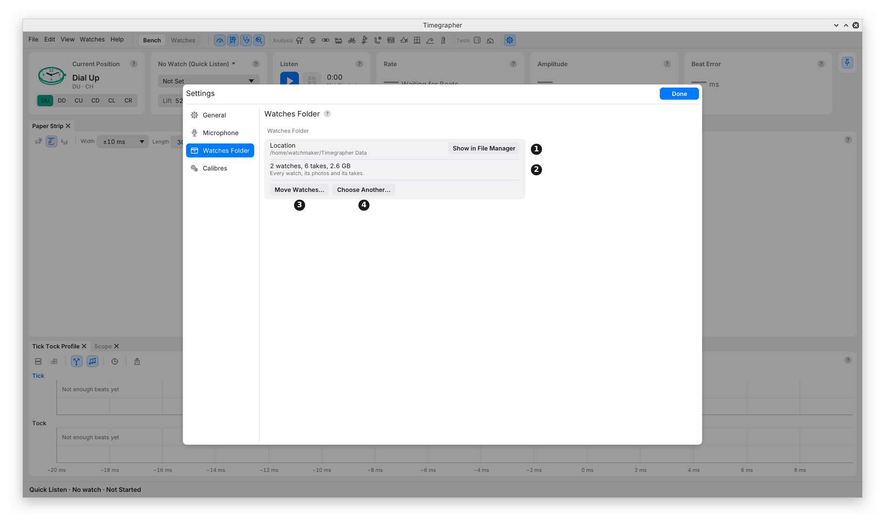
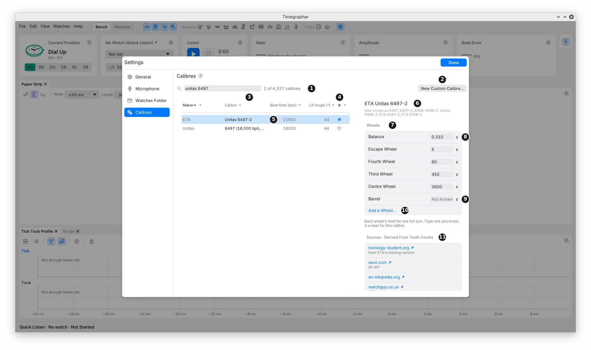

# 24. Settings and Calibres

**What it covers:** the Settings window's General and Watches Folder
pages, and Manage Calibres, where you look up any calibre's beat rate,
lift angle and wheels, add what you know, and keep a short list.

**Why you'd use it:** the calibre decides the lift angle the amplitude
is worked out from, and the wheels Steadiness names its cycles after. A
calibre missing from the list, or a wheel nobody has given, is yours to
add, and every take of that calibre then uses it.

Open Settings with the gear at the right of the top row, **Edit >
Settings…** (**Timegrapher > Settings…** on a Mac) or **Ctrl+,**
(**Cmd+,**). It opens at the page you left it on. **Done**, Escape or a
click outside closes it. The Microphone page is in chapter 3.

## General

| Setting | What it does | Why you'd change it |
| --- | --- | --- |
| **Appearance** | **Auto** follows the computer's light or dark setting; **Light** and **Dark** override it. | To match the room's light at the bench. |
| **Listen When the App Opens** | Starts Quick Listen at every launch once the microphone is set up. On unless switched off. | Off when another program records from the same microphone. |
| **Keep Awake** | Asks the computer not to sleep while the app listens; the screen can still lock. On unless switched off. If the system refuses, the caption says so. | Leave on: a computer that sleeps leaves a break in the take. A Power Reserve Test keeps it awake whatever this says. |
| **Run After Saving a Take** | A command of your own, run each time a take is saved with listening stopped (a Stop, Save…, Save Again). The take's folder is added as the command's last argument and is in the variable `TIMEGRAPHER_TAKE`. The app doesn't wait for it; what it exits with, a failure such as a mistyped command included, goes only to the app's log, so try it once by hand first. Empty, the default, runs nothing. A take saving into its folder as it goes doesn't run it until it stops. | To hand each take to another program, such as a shop's records system or a backup. |
| **Check for Updates at Start** | Asks GitHub once at start whether a newer release is out; if so, the status bar offers it. Nothing installs itself, and the request carries no account or identifier. | Off where the computer has no internet. **Help > Check for Updates…** checks at any time. |

## Watches Folder

| Mark | Part | What it does | Why you'd use it |
| --- | --- | --- | --- |
| 1 | **Location** | Where the Watches folder is (`Timegrapher Data` in your home folder unless you chose another), with **Show in File Manager** (**Show in Finder** on a Mac, **Show in Explorer** on Windows). | To back it up or look inside (chapter 23). |
| 2 | What it holds | How many watches and takes, and their size. | To see how much space the takes use. |
| 3 | **Move Watches…** | Moves the whole folder into one you pick, after asking. Onto another disk it is copied, checked, and only then removed. It is refused while takes are still being kept as FLAC. | To move the takes to a larger disk. |
| 4 | **Choose Another…** | Uses a Watches folder elsewhere, or starts a new one in an empty folder; nothing is moved. **Use the Default** then goes back. | A folder kept in sync with another computer, or a second bench. |

Only one copy of the app at a time can change the watches: a second
copy opens them to read only and says so here. The folder can't be
moved while another copy has it open, and the app stays open until a
move finishes.

## Manage Calibres

**Calibres**, in Settings, or **Manage Calibres…** at the foot of the
Calibre menu, opens it. From the Calibre menu with a beat rate known,
the table starts filtered to that rate and says so, with **Show All**.

| Mark | Part | What it does | Why you'd use it |
| --- | --- | --- | --- |
| 1 | Search | Finds calibres by maker, calibre or another name ("dd 3235", "sw200"), and counts them: "2 of 4,537 calibres". | To find one calibre. |
| 2 | **New Custom Calibre…** | Adds a calibre the list doesn't have, under the maker **Custom**, always at the top. | A vintage or obscure movement. |
| 3 | The columns | **Maker**, **Calibre**, **Beat Rate (bph)** and **Lift Angle (°)**. Click a heading to sort; its ▾ opens a filter with a tickbox for each value, as a spreadsheet's does. A value not given is a dim "—". | To work through one maker, or every calibre at one beat rate. |
| 4 | The star | Filled for a calibre on the short list. Click it to add or remove. | To keep the calibres you see often at the top of the Calibre menu. |
| 5 | A calibre | Click to see it in full on the right. | |
| 6 | Its name | And the other names it goes by. | |
| 7 | **Wheels** | Each wheel's time for one full turn: the balance, escape, fourth, third and centre wheels and the barrel first, then any other the list names. The hover on each says where its figure comes from. | Steadiness names a cycle after the wheel whose period it matches (chapter 11). |
| 8 | A wheel's period | In seconds. | |
| 9 | **Not Known** | A wheel nobody has given. Type its period and it is kept for that calibre, marked Custom, with **Clear** to go back. | When you have counted the teeth yourself. |
| 10 | **Add a Wheel…** | Adds another wheel by name and period. | A wheel the list leaves out. |
| 11 | **Sources** | How the figures are known ("Derived From Tooth Counts", "Published List"), each source with what it says, then the list's notes. | To weigh a figure before you rely on it. |

At the foot of the details, **Share with the Project…** opens a GitHub
issue in the browser, filled in with what you added, for you to look
over and send; nothing is sent from the app. A custom calibre also has
**Delete Calibre**.

**A custom calibre** starts with no wheels, since nothing about an
obscure movement is assumed. Its Name, Maker, Beat Rate and Lift Angle
can be changed in its details; the lift angle is kept between 10° and
90°. Typing its beat rate fills in the balance's
period, two beats: 7200 ÷ bph seconds, 0.25 s at 28,800 bph.

**The short list** starts as the list's common and modern calibres.
**Reset the Short List**, in the star column's filter, goes back to it.

**Where your additions are kept:** wheel periods and custom calibres go
in `calibres.json` in the app's settings folder, which the command line
and the MCP (Model Context Protocol) server, which lets an AI chat app
use the timegrapher (chapter 26), read too. If that file can't be read, the page says
so and keeps any change only until the app closes, so nothing overwrites
it; repair or move the file, then start the app again.

## What a Calibre Pick Does

Chapter 5 gives the Calibre menu. A pick fills in the calibre's lift
angle, where the list gives one, and names the cycles Steadiness finds
after its own wheels. In Quick Listen it also sets the beat rate to the
calibre's, and **Not Set** goes back to Auto; a watch picked keeps its
own beat rate. If the watch beats at another rate than the calibre, a
chip on the Calibre card says so, such as "Dandong 3235 is 28800 bph". The pick belongs to the watch on
the stand and isn't kept between runs; a watch in the Watches view keeps
its own.

## What It Can't Tell You

- **Whether a published lift angle is right for your watch.** Sources
  differ, and the list keeps differing figures as separate entries, each
  with its source. The amplitude moves with the lift angle (M4).
- **Whether a figure you add is right.** It is used as you typed it,
  marked Custom.

---

Previous: [Takes and Sound Files](23-takes-and-sound-files.md) ·
Next: [The Command Line](25-command-line.md)
